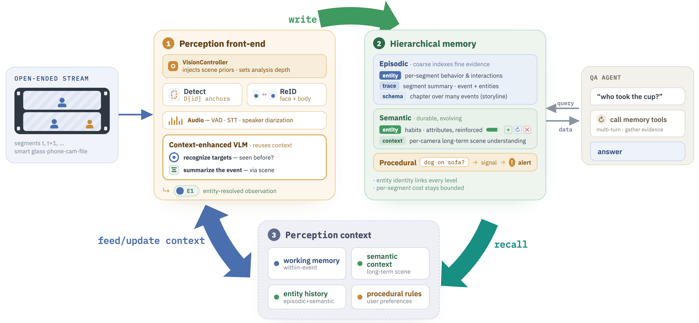
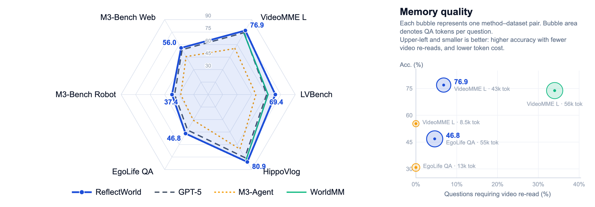
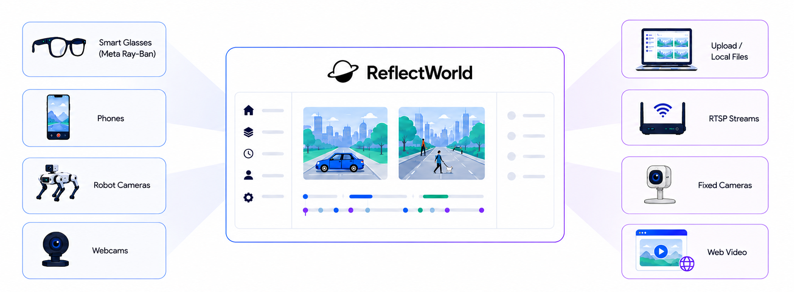
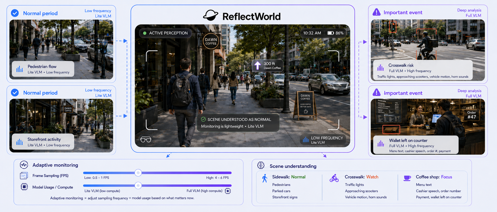
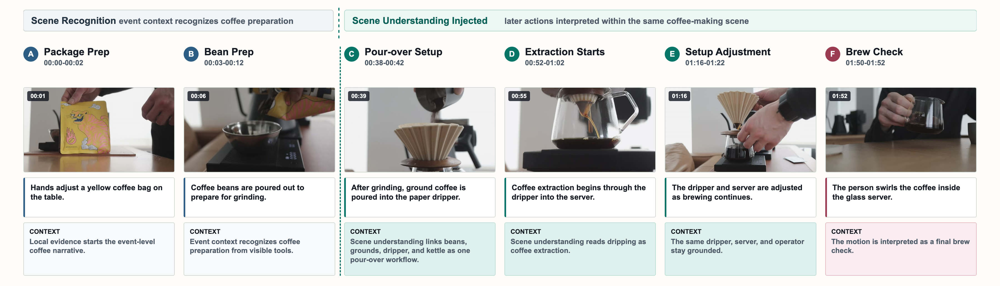
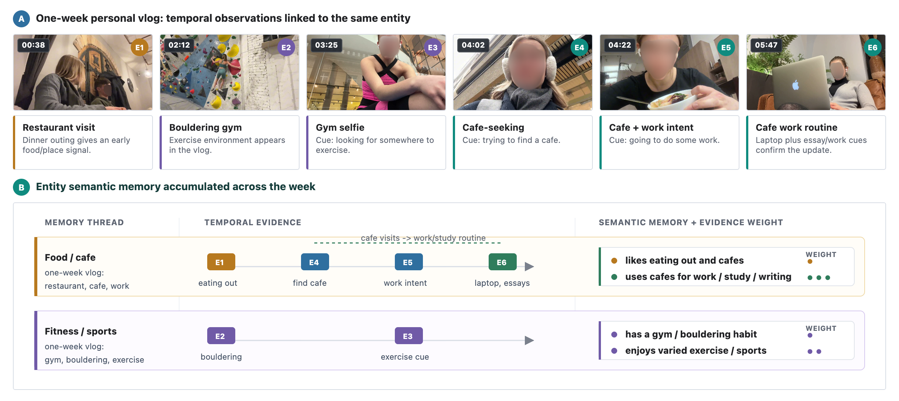
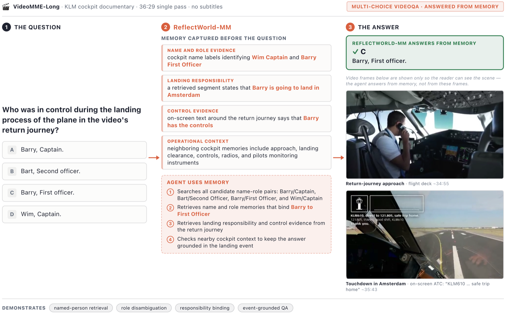
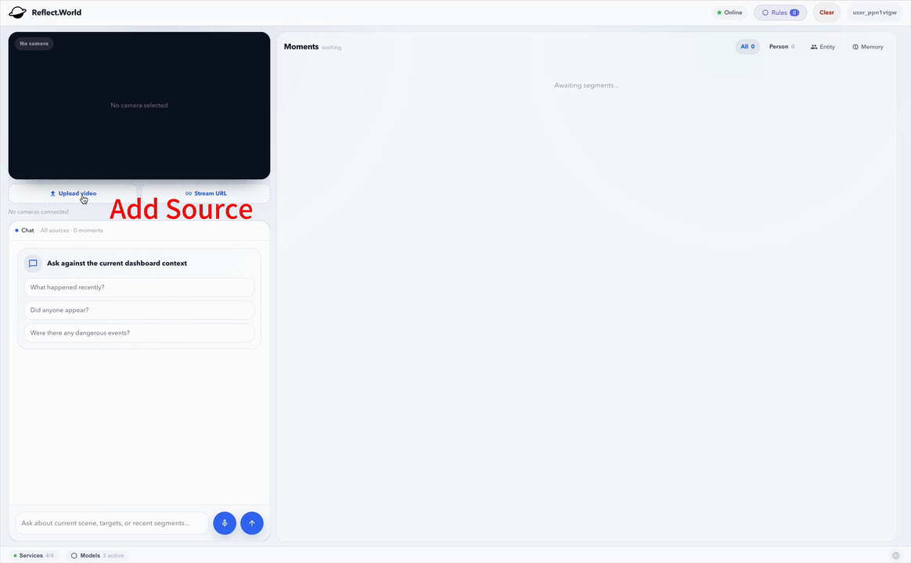
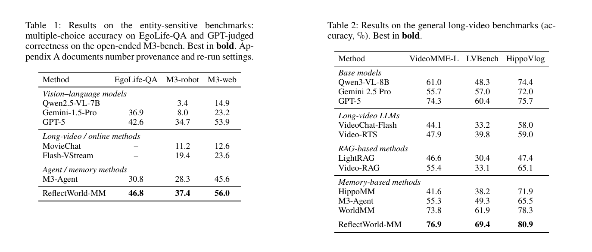

<div align="center">

# ReflectWorld

### Map the real world into cyber memory.

**ReflectWorld is live world memory for AI agents.**
It turns camera streams into persistent visual experience: what happened, who or what appeared, what changed, and what an agent should remember next.

[](https://arxiv.org/abs/2607.09759)
[](LICENSE)
[](https://nodejs.org)
[](https://www.typescriptlang.org)
[](https://www.python.org)
[](docs/contributing/development.md)

[Why ReflectWorld](#why-reflectworld) · [Core Capabilities](#core-capabilities) · [Showcase](#showcase) · [Benchmark Results](#benchmark-results) · [Paper](#paper--citation) · [Quick Start](#quick-start) · [Runtime Shape](#runtime-shape) · [Docs](#documentation)

**Want to try it first?** Jump to [Quick Start](#quick-start) and run the standalone Dashboard locally.

</div>

---

## Why ReflectWorld

AI agents are becoming fluent in text, code, tools, and APIs. But their visual perception is still mostly episodic: they see isolated clips, answer one question, and forget the continuity between people, places, events, and time. ReflectWorld is built for a different premise: **an agent should remember the world it has already seen**.

ReflectWorld turns live camera streams into persistent, queryable visual memory: what happened, who or what appeared, what changed, what evidence was stored, and what matters now. The shift is from "what is happening in this clip?" to "what has this agent seen over time, who or what keeps appearing, what changed, and why does it matter now?" It is not a video summarizer; it is a **world memory layer for agents**.

<p align="center">
  
</p>

ReflectWorld is designed for long-running visual environments: homes, offices, labs, robot-mounted cameras, mobile viewpoints, public demos, and any setting where one-time scene descriptions are not enough. Because visual memory can involve people, places, and sensitive routines, privacy is a system boundary: raw source files, non-VLM recognition models, media artifacts, identity evidence, and persistent memory stay on your machine; configured model providers receive only the inputs needed for the capabilities you explicitly enable.

**Benchmark snapshot:**

<p align="center">
  
</p>

Evaluations exclude dataset-provided subtitles or captions. WorldMM does not maintain explicit entity identities, so it is not evaluated on EgoLife-QA or M3-bench. Memory-quality values come from Table 3 of the [ReflectWorld-MM paper](https://arxiv.org/abs/2607.09759). See [Benchmark Results](#benchmark-results) for full tables and provenance.

---

## Core Capabilities

### Any Video Feed
ReflectWorld is not tied to one camera, device, or demo format. It can ingest fixed cameras, RTSP streams, uploads, webcams, phones, smart-glasses footage such as Meta Ray-Ban recordings, robot cameras, local files, and compatible web video. If a source can become a video stream, ReflectWorld can turn it into agent-ready perception.

<p align="center">
  
</p>

### Active Adaptive Perception
ReflectWorld does not passively caption frames. A higher-level scene agent reads the environment, injects scene knowledge, and shifts perception toward what matters now. Quiet scenes stay lightweight; important moments receive deeper visual, speech, and entity analysis. The point is not only to save compute, but to make perception active, scene-aware, and responsive to context.

<p align="center">
  
</p>

### Narrative Scene Memory
ReflectWorld turns fragmented moments into a continuous visual narrative. It links events over time, preserves what changed, generates summaries at multiple granularities, and can explain why a moment mattered. Instead of flooding users with isolated alerts or one-off captions, it keeps describing the world as an unfolding story an agent can follow.

The coffee example below shows how scene understanding turns later moments into one coherent brewing workflow, not isolated captions.

<p align="center">
  
</p>

### Persistent Entity Memory
ReflectWorld remembers recurring entities across time. People, objects, and other important subjects accumulate sightings, roles, actions, speech when enabled, routines, semantic facts, and history. When an entity reappears, the system can understand the current moment against what it has already observed, which is the difference between detecting motion and knowing a world.

The weekly vlog example below shows how repeated observations of the same person accumulate into semantic memory over time.

<p align="center">
  
</p>

### Agent-Ready Visual Memory
Memory is not useful unless an agent can use it. ReflectWorld exposes visual experience as searchable evidence: moments, frames, speech, summaries, entity context, semantic records, and procedural rules. Agents can ask what happened, who appeared, what changed, why it mattered, and inspect the underlying evidence instead of guessing from a single clip.

The cockpit example below shows how stored role, responsibility, and control evidence let the agent answer from memory.

<p align="center">
  
</p>

---

## Showcase

ReflectWorld's Dashboard is a live workspace for world memory. The demo below shows the system moving from an empty dashboard into an active visual-memory session: add a source, start analysis, watch moments accumulate, inspect entities and memory, then ask questions against the stored context.

<p align="center">
  
</p>

### Dashboard Demo: Source To Memory

- **Source onboarding:** upload a local video or attach a stream without leaving the workspace.
- **Live analysis:** the moment timeline fills as perception writes summaries, entities, and evidence into memory.
- **Memory inspection:** entity and memory tabs expose what the system has retained, not just what the latest frame shows.
- **Chat recall:** questions are answered against the dashboard context and stored visual evidence.

### Trace-Backed Examples

The cases below show the same runtime behavior on real benchmark videos. ReflectWorld first writes scene summaries, speech, text, identity clues, entity context, and visual evidence into memory; the QA agent later answers by retrieving that stored experience instead of starting from an isolated clip prompt.

<table>
<tr>
<td width="33%">
<a href="https://www.youtube.com/watch?v=2LDriAWltwM"></a><br/>
<a href="https://www.youtube.com/watch?v=2LDriAWltwM">Watch video on YouTube</a><br/>
<strong>Cross-Day Entity Recall</strong><br/>
Compares the same woman across non-adjacent Wednesday and Friday moments.<br/><br/>
<strong>Stored evidence:</strong> day anchors, same-person continuity, visual frames.<br/><br/>
<strong>Answer:</strong> curly hair and different trousers.
</td>
<td width="33%">
<a href="https://www.youtube.com/watch?v=K37YKK9h9pA"></a><br/>
<a href="https://www.youtube.com/watch?v=K37YKK9h9pA">Watch video on YouTube</a><br/>
<strong>Role-Aware Event Reasoning</strong><br/>
A cockpit video asks who controlled the return landing, requiring names, roles, and event context.<br/><br/>
<strong>Stored evidence:</strong> name labels, pilot roles, landing context, control text.<br/><br/>
<strong>Answer:</strong> Barry, First Officer.
</td>
<td width="33%">
<a href="https://www.youtube.com/watch?v=hKzzdyexVgM"></a><br/>
<a href="https://www.youtube.com/watch?v=hKzzdyexVgM">Watch video on YouTube</a><br/>
<strong>Speech-Grounded Place Recall</strong><br/>
A spoken phrase retrieves the right memory, then visual evidence grounds the place.<br/><br/>
<strong>Stored evidence:</strong> quoted speech, place memory, overlook frames, background context.<br/><br/>
<strong>Answer:</strong> Lover's Leap overlook.
</td>
</tr>
</table>

<details>
<summary><strong>Case 1: Cross-Day Entity Recall</strong></summary>

- **Video:** [VideoMME Long - `2LDriAWltwM`](https://www.youtube.com/watch?v=2LDriAWltwM)
- **Question:** What is the difference in appearance between the female lead in the video, Friday and Wednesday?
- **Options:**
  - A. On Friday her hair was shorter compared to when it was on Wednesday, and on Friday she wore different trousers than she did on Wednesday.
  - B. Friday she didn't wear a coat, Wednesday she wore a coat.
  - C. On Friday, her hair was longer and straighter and she wore different trousers than on Wednesday.
  - D. On Friday, her hair turned curly and she wore different trousers than she did on Wednesday.
- **ReflectWorld Answer:** D.

**Why this is hard:**

The answer depends on comparing the same person across distant day-specific segments, not on recognizing one object in one clip.

**Memory already stored before QA:**

- **Wednesday anchor:** Memory contains a segment where the creator states it is Wednesday, November 1.
- **Friday anchor:** Memory contains a later schedule/workout segment with visible Friday context, including text like `Friday: pull`.
- **Neighboring timeline context:** Related segments around both anchors preserve nearby appearance and activity context instead of relying on a single search hit.
- **Visual evidence:** Stored visual frames let the agent compare the same woman's appearance across non-adjacent day segments.

**Evidence trace:**

1. Uses appearance-related answer candidates as retrieval probes for initial evidence.
2. Retrieves the Wednesday anchor and the Friday anchor from memory.
3. Expands neighboring segments around both anchors to recover local visual context.
4. Inspects stored visual evidence around the relevant day anchors and compares the same person across time.
5. Selects `D`: on Friday her hair turned curly and she wore different trousers.

**Capability shown:** long-range temporal navigation, same-person continuity, timeline expansion, and visual evidence replay.

</details>

<details>
<summary><strong>Case 2: Role-Aware Event Reasoning</strong></summary>

- **Video:** [VideoMME Long - `K37YKK9h9pA`](https://www.youtube.com/watch?v=K37YKK9h9pA)
- **Question:** Who was in control during the landing process of the plane in the video's return journey?
- **Options:**
  - A. Barry, Captain.
  - B. Bart, Second officer.
  - C. Barry, First officer.
  - D. Wim, Captain.
- **ReflectWorld Answer:** C.

**Why this is hard:**

The question requires binding a person to a role and then binding that role to a specific landing event in the return journey.

**Memory already stored before QA:**

- **Name and role evidence:** Memory records cockpit name labels identifying `Wim Captain` and `Barry First Officer`.
- **Landing responsibility:** A retrieved segment states that Barry is going to land in Amsterdam.
- **Control evidence:** On-screen text around the return journey says that Barry has the controls.
- **Operational context:** Neighboring cockpit memories include approach, landing clearance, controls, radios, and pilots monitoring instruments.

**Evidence trace:**

1. Uses candidate name-role pairs as retrieval probes for initial evidence.
2. Retrieves name and role memories that bind Barry to First Officer.
3. Retrieves landing responsibility and control evidence from the return journey.
4. Checks nearby cockpit context to keep the answer grounded in the landing event.
5. Answers `C`: Barry, First Officer.

**Capability shown:** named-person retrieval, role disambiguation, responsibility binding, and event-grounded QA.

</details>

<details>
<summary><strong>Case 3: Speech-Grounded Place Recall</strong></summary>

- **Video:** [HippoVlog - `hKzzdyexVgM`](https://www.youtube.com/watch?v=hKzzdyexVgM)
- **Question:** What activity are the main characters engaged in when the woman says, "This place holds so many memories for us," and what is visually noticeable in the background?
- **Options:**
  - A. Exploring Ruby Falls; the background shows the waterfall illuminated with colored lights.
  - B. Walking across the Swinging Bridge at Rock City; the background shows the lush greenery and rock formations.
  - C. Standing at Lover's Leap; the background shows a panoramic view of seven states.
  - D. Enjoying ice cream at Coolidge Park; the background shows the Walnut Street Bridge.
- **ReflectWorld Answer:** C.

**Why this is hard:**

The spoken phrase identifies the relevant memory, but the answer also requires grounding that moment in the visual place and background scene.

**Memory already stored before QA:**

- **Quoted speech memory:** The phrase `This place holds so many memories for us` is stored as a searchable handle.
- **Place memory:** Stored place summaries include scenic overlook segments and engagement-memory context around `Lover's Leap`.
- **Visual background:** The retrieved segment preserves the overlook scene, distant rock outcrop, and panoramic background.
- **Replay handles:** Stored moment and frame references let the agent inspect visual evidence around the spoken moment rather than answering from text alone.

**Evidence trace:**

1. Uses place/activity candidates and the quoted phrase as retrieval probes.
2. Retrieves the speech memory containing `so many memories for us`.
3. Retrieves the moment where the speaker points toward the distant rock outcrop and explains the Lover's Leap memory.
4. Inspects stored visual evidence for the overlook segment.
5. Selects `C`: standing at Lover's Leap with a panoramic background.

**Capability shown:** speech-triggered memory retrieval, place grounding, visual background verification, and evidence-first QA.

</details>

**Media provenance.** Several figures and example thumbnails above use public
benchmark/web-video frames to illustrate the academic evaluation setting. Source
links and reuse limits are listed in [Third-Party Notices](THIRD_PARTY_NOTICES.md#research-and-demo-media-assets).
This repository does not redistribute benchmark videos; use permitted source
videos or your own footage for public demos.

## Benchmark Results

<p align="center">
  
</p>

Notes:

- All evaluations were run without dataset-provided subtitles or captions.
- The [paper](https://arxiv.org/abs/2607.09759) reports the method as `ReflectWorld-MM`; this repository uses `ReflectWorld` as the project name.
- Reproduction and lmms-eval worker entry points live in [eval/benchmark/](eval/benchmark/README.md).

---

## Quick Start

Most users should start with the standalone Dashboard. This README shows the
short path; the full first-run walkthrough is in the
[Quick Start guide](docs/user-guide/quickstart.md). Plugin, benchmark,
development, and local-model paths are available under Advanced Paths.

> **Prerequisites:** [Node.js >= 22](https://nodejs.org) and one vision-capable API key from an OpenAI-compatible provider or Gemini. macOS and Linux are supported.

### Option A: Run Standalone with the Dashboard

Use this path for the fastest local run. The standalone CLI starts ReflectWorld
and serves the Dashboard from the same process.

Create a `.env` in the directory where you will run the CLI:

```bash
VLM_PROVIDER=openai
VLM_MODEL=gpt-5-mini
VLM_MODEL_LITE=gpt-5-mini
VLM_API_KEY=your-vlm-api-key
VLM_BASE_URL=https://api.openai.com/v1
LLM_MODEL=gpt-5-mini
EMBEDDER_PROVIDER=openai
EMBEDDER_MODEL=text-embedding-3-small
EMBEDDER_API_KEY=your-embedder-api-key
EMBEDDER_BASE_URL=https://api.openai.com/v1
EMBEDDING_DIMS=1536
```

Start ReflectWorld with the CLI:

```bash
npx @reflectworld/reflectworld start
#  -> ReflectWorld dashboard at http://localhost:3210
```

Then open **http://localhost:3210**. Add a source, upload a video, or connect a stream, then watch moments, entities, memory, and chat come alive. Dashboard chat uses `LLM_MODEL`.

> The dashboard starts before all background services finish initialization. On first run, dependency setup may take a few minutes; memory features show "starting" until the memory backend is ready.

<details>
<summary><strong>Advanced Paths: OpenClaw, Benchmarks, Dashboard Development, and Local Perception</strong></summary>

### Option B: Use ReflectWorld as an OpenClaw Plugin

Use this path when OpenClaw is your agent runtime and ReflectWorld should be
loaded as a plugin.

```bash
openclaw plugins install @reflectworld/reflectworld
npx @reflectworld/reflectworld configure
openclaw gateway restart
```

`configure` writes OpenClaw `pluginConfig`, validates it, and restarts the
gateway when possible. Plugin mode does **not** read a repository `.env`; use
the OpenClaw config written by `configure`.

### Option C: Run Benchmarks / Agent-QA

Use this path from a repository checkout when you want to evaluate ReflectWorld
with lmms-eval or the memory-backed Agent-QA pipeline.

```bash
npm install
cp .env.example .env
# Fill VLM_*, LLM_MODEL, and QA_MODEL.
# Optional: set QA_API_KEY / QA_BASE_URL to route Agent-QA separately.
npm run build
npx @reflectworld/reflectworld setup --level 1 --yes --accept-model-licenses
npm run benchmark:setup
npm run benchmark:run -- --dataset ~/benchmark-data/dataset.json --smoke
```

`QA_MODEL` is used by benchmark and Agent-QA code. It is separate from
Dashboard chat, which uses `LLM_MODEL`. See the
[benchmark guide](eval/benchmark/README.md) for lmms-eval workers, custom
tasks, and dataset-specific launchers.

### Option D: Develop or Demo the Dashboard

Use this path only when working from the monorepo. Normal standalone users do
not need these scripts because `npx @reflectworld/reflectworld start` already
serves the Dashboard.

```bash
npm install
npm run build
npx @reflectworld/reflectworld setup --yes
npm run dashboard:demo
# or: npm run dashboard:main
```

### Option E: Enable Local Perception

```bash
npx @reflectworld/reflectworld enable-level1
npx @reflectworld/reflectworld setup --level 1 --yes --accept-model-licenses
```

`setup --level 1` acquires every Level 1 model in one command. It resolves which models are needed (from the perception level plus the STT / body-reid config), shows each model's license, then acquires each the way its license allows:
- **license-clean models** (Silero VAD, Moonshine STT — MIT) download directly, no gate;
- **restricted models that upstream ships as ready ONNX** (ArcFace via InsightFace, RTMPose via MMPose — non-commercial) download directly but require accepting their license;
- **restricted models distributed only as training weights** (YOLO26m, RetinaFace, CLIP-ReID) have their open-source weights downloaded and converted to ONNX locally, in a throwaway Python env (via the bundled `uv`).

ReflectWorld never redistributes weights; the resulting ONNX stays on your machine.

`--accept-model-licenses` acknowledges the AGPL / non-commercial licenses in the table below (or confirm interactively). Without it, restricted models are skipped and setup stays at Level 0.

| Capability | Default model | Acquisition | License | Installed when |
|---|---|---|---|---|
| Object detection | `yolo26m` | download weights + convert | **AGPL-3.0** (Ultralytics; commercial → Enterprise) | Level 1 |
| Face detection + landmarks | `retinaface-resnet50` | download weights + convert | code MIT, **weights non-commercial** (WIDER FACE) | Level 1 |
| Face ReID / embedding | `arcface-mbf` (`w600k_mbf`) | direct download (InsightFace pack) | **non-commercial** (InsightFace) | Level 1 |
| Body ReID / embedding | `clip-reid-vitb` | download weights + convert | code MIT, **weights research-only** (Market-1501) | `REFLECTWORLD_BODY_REID_ENABLED=true` |
| Body pose (17-pt) | `rtmpose-s` | direct download (MMPose pack) | Apache-2.0 code + body7 datasets | `REFLECTWORLD_BODY_REID_ENABLED=true` |
| Local speech recognition | `Moonshine Tiny int8` | direct download | **MIT** | `STT_PROVIDER=moonshine` (skipped for ElevenLabs) |

**Why convert locally?** The detection and face/body model weights carry AGPL or non-commercial terms, so ReflectWorld ships only code + conversion scripts — the download-and-convert runs on your machine, keeping the license obligation with you and producing ONNX that satisfies the same model contract, numerically validated within tolerance of the reference models. For commercial use, substitute commercially-licensed models. See [THIRD_PARTY_NOTICES.md](THIRD_PARTY_NOTICES.md).

Each capability is a replaceable default, not a hard dependency: any model or provider that satisfies the expected input/output contract can be swapped in without touching the memory layer.

See the [Quick Start guide](docs/user-guide/quickstart.md) and
[installation guide](docs/user-guide/installation.md) for details.

</details>

---

## Runtime Shape

ReflectWorld watches a stream, cuts it into moments, extracts visual and audio evidence, resolves recurring entities, writes the result into memory, and exposes that memory through the Dashboard and agent tools.

- **Memory first:** observations are written before QA, so answers retrieve from stored experience instead of a one-off prompt.
- **Evidence grounded:** identities, roles, events, and answers stay tied to moments, frames, speech, and memory records.
- **Entity aware:** recurring subjects accumulate sightings, semantic profiles, and recent activity over time.
- **Runtime ready:** live sources, uploads, configurable models, local-first storage, and Dashboard state are part of the same system.

Implementation details live in the [architecture overview](docs/architecture/overview.md).

---

## Documentation

The public docs are intentionally compact: one architecture overview, practical
user guides, stable public references, and contributor setup. Start at the
[documentation hub](docs/README.md) or jump directly to:

| Goal | Read |
|---|---|
| Run ReflectWorld for the first time | [Quick Start](docs/user-guide/quickstart.md), [Installation](docs/user-guide/installation.md) |
| Use the Dashboard | [Dashboard Guide](docs/user-guide/dashboard.md), [HTTP API](docs/reference/http-api.md) |
| Configure models, storage, ports, and security modes | [Configuration Guide](docs/user-guide/configuration.md), [Configuration Reference](docs/reference/configuration.md), [CLI Reference](docs/reference/cli.md) |
| Understand the implementation | [Architecture Overview](docs/architecture/overview.md) |
| Contribute changes | [Development Setup](docs/contributing/development.md), [Testing Guide](docs/contributing/testing.md) |

---

## Privacy & Responsible Use

ReflectWorld processes visual data and, when local recognition (Level 1) is enabled, biometric signals such as face embeddings used for re-identification. Use it responsibly:

- **Local-first by design.** ReflectWorld stores source files, non-VLM recognition models, media, identity evidence, and memory on your machine. Enabled remote providers receive only the request payloads required for capabilities you explicitly configure, which may include VLM frames, prompt or chat text, embedding input text, or voice-window audio for cloud speech-to-text. Choose providers consistent with your privacy and data-residency requirements.
- **You control retention.** Memory and media are stored locally in SQLite, Qdrant, and on-disk media. Automatic retention covers generated media and local text or diagnostic records; persistent semantic and ReID memory, along with uploaded original videos, can be removed through the documented APIs. ReflectWorld does not send data to a ReflectWorld-operated service.
- **Your compliance responsibility.** Recognizing people may be regulated in your jurisdiction (e.g. GDPR, CCPA, BIPA). You are responsible for obtaining any required consent and for lawful deployment, including any signage and data-subject rights.
- **Model licenses.** Default recognition models may be research-only. See [THIRD_PARTY_NOTICES.md](THIRD_PARTY_NOTICES.md) before commercial use.

---

## Paper & Citation

ReflectWorld is the open-source implementation of
[ReflectWorld-MM: An Entity-Oriented Multimodal Memory System for Open-Ended Video Streams](https://arxiv.org/abs/2607.09759).

```bibtex
@article{ma2026reflectworldmm,
  title={ReflectWorld-MM: An Entity-Oriented Multimodal Memory System for Open-Ended Video Streams},
  author={Ma, Xiaokang and Sun, Yifan and Jin, Zhihong and Gu, Jie and Luo, Yudong and Shao, Shenyi and Tang, Chu and Chen, Jingmin and Pu, Li},
  journal={arXiv preprint arXiv:2607.09759},
  year={2026}
}
```

---

## Contributing

Contributions are welcome. Start with [docs/contributing/development.md](docs/contributing/development.md) for environment setup and repository layout, and [docs/contributing/testing.md](docs/contributing/testing.md) for the testing discipline.

Common commands:

```bash
npm run lint
npm run typecheck
npm run test
```

The public CI runs lint, TypeScript checks, and the Vitest suite.

## License

[Apache-2.0](LICENSE) © ReflectWorld Contributors
