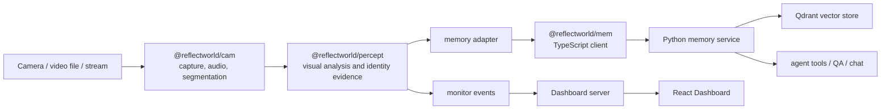

# ReflectWorld Architecture

ReflectWorld is a local-first visual memory runtime. It turns camera streams and
video files into structured observations, stores those observations in
persistent memory, and exposes the resulting state to the Dashboard and agent
tools.

This page is intentionally compact. It explains the public architecture shape
without documenting every internal mechanism.

## System Shape

At runtime, the TypeScript packages run mostly in one Node.js process. Separate
processes are used only where the runtime boundary requires them:

- **Qdrant** for vector storage.
- **Python memory service** for memory search, write, and merge operations.
- **go2rtc** when live stream routing is needed.

The default deployment is local-first. Source media, generated media artifacts,
local recognition model outputs, memory state, and vector data stay on the
machine running ReflectWorld. Configured model providers receive only the VLM,
LLM, STT, or embedding requests needed for the features you enable.

## Main Packages

| Package | Responsibility |
|---|---|
| `packages/cam` | Connects to file, RTSP, phone, webcam, and upload sources; extracts frames/audio; cuts the stream into segments. |
| `packages/percept` | Analyzes each segment with local evidence and VLM calls; extracts summaries, subjects, speech context, risk signals, and identity evidence. |
| `packages/mem` | TypeScript client for the memory service. |
| `services/mem` | Python/FastAPI service for memory storage, retrieval, semantic context, and vector search. |
| `packages/reflectworld` | Orchestrator, CLI, runtime services, state directories, configuration, and Dashboard API. |
| `packages/dashboard` | React UI for sources, segment timeline, entities, memory, and chat. |
| `packages/shared` | Shared event and data contracts used across packages. |
| `packages/host` | Development/demo host for running the Dashboard and tool APIs locally. |

## Segment Flow

1. **Capture** reads a source and emits media frames, audio, and timestamps.
2. **Segmentation** groups frames into moments using time, motion, and speech
   cues.
3. **Perception** analyzes the segment. Level 0 uses VLM analysis only. Level 1
   adds local detection and ReID evidence before VLM reasoning.
4. **Memory writing** stores segment summaries, speech snippets, entity
   observations, semantic context, and media references.
5. **Dashboard projection** streams versioned state updates to the browser.
6. **Agent recall** searches memory and can inspect visual evidence when it
   needs grounded answers.

## Memory Model

ReflectWorld stores memory at multiple levels of abstraction:

- **Segment memories**: what happened in a specific time range.
- **Entity memories**: what was observed about a recurring person, object, or
  subject.
- **Semantic context**: longer-term scene context, routines, names, and facts
  that help future perception and retrieval.
- **ReID vectors**: local identity evidence used to link repeated sightings.

The important product rule is that memory is evidence-backed. Answers and UI
state should remain tied to segments, timestamps, speech, frames, and memory
records rather than free-floating summaries.

## Identity Model

Identity is treated as evidence plus decision:

- Local detection and ReID provide evidence.
- VLM analysis can describe people and objects in human terms.
- The runtime resolves that evidence into stable entity state when confidence is
  sufficient.

This keeps identity continuity useful without making a single model output the
only source of truth.

## Dashboard And Events

The Dashboard is a live projection of runtime state. Backend services emit
shared monitor events, and the Dashboard server converts them into state updates
for the browser. This lets users inspect:

- active sources,
- recent segments,
- entities and sightings,
- memory records,
- chat answers grounded in memory.

HTTP and event contracts are documented in the reference section:

- [HTTP API](../reference/http-api.md)

## Configuration And Runtime Modes

ReflectWorld supports two common runtime shapes:

- **Standalone**: run from this repository or an npm package using `.env`.
- **OpenClaw plugin mode**: configure through the host plugin configuration
  flow.

Both shapes use the same core packages. See:

- [Configuration guide](../user-guide/configuration.md)
- [Configuration reference](../reference/configuration.md)
- [CLI reference](../reference/cli.md)

## Design Boundaries

ReflectWorld's public architecture follows a few practical boundaries:

- Keep media and memory local unless the user chooses external providers.
- Keep raw source data, generated media, and model artifacts out of the source
  repository.
- Treat memory writes as evidence, not disposable logs.
- Treat benchmark runners as optional development tools, not production runtime
  dependencies.
- Keep local model weights downloaded by setup, not committed to the repo.

For installation and first run instructions, start with the
[Quick Start](../user-guide/quickstart.md).
