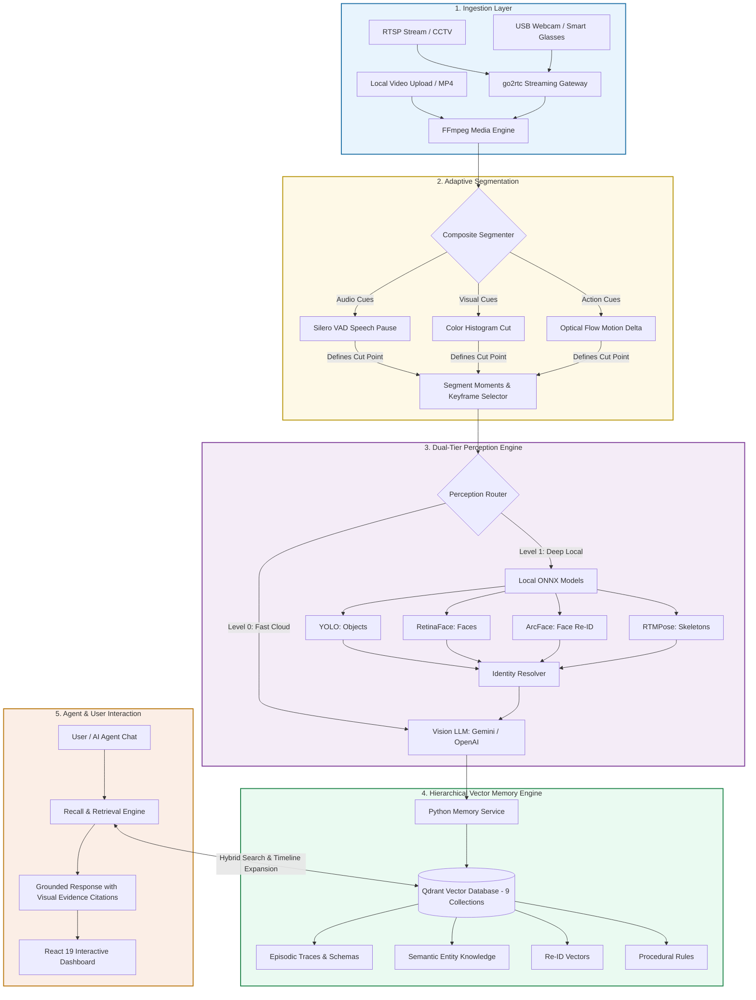
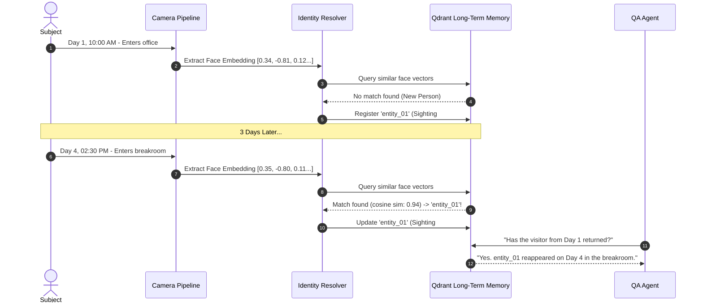

# 🌐 ReflectWorld: Project Overview & Vision

> **Map the Real World into Cyber Memory.**  
> *A continuous, entity-oriented multimodal memory system for AI agents processing open-ended video streams.*

---

## 📌 Table of Contents
1. [The Paradigm Shift: From Episodic Vision to World Memory](#-the-paradigm-shift-from-episodic-vision-to-world-memory)
2. [What is ReflectWorld?](#-what-is-reflectworld)
3. [Core Capabilities at a Glance](#-core-capabilities-at-a-glance)
4. [High-Level Architectural Flow](#-high-level-architectural-flow)
5. [Dual-Tier Perception Philosophy: Level 0 vs. Level 1](#-dual-tier-perception-philosophy-level-0-vs-level-1)
6. [Why Entity-Oriented Memory Matters](#-why-entity-oriented-memory-matters)
7. [Research Foundation & Benchmark Performance](#-research-foundation--benchmark-performance)
8. [Real-World Applications](#-real-world-applications)
9. [Privacy & Local-First Guarantees](#-privacy--local-first-guarantees)
10. [Quick Navigation to Other Phases](#-quick-navigation-to-other-phases)

---

## 💡 The Paradigm Shift: From Episodic Vision to World Memory

Over the last several years, AI has made monumental leaps in text comprehension, tool execution, and single-image understanding. However, when it comes to video, state-of-the-art Multimodal Large Language Models (MLLMs like GPT-4o, Claude 3.5, and Gemini) still suffer from a fundamental limitation: **they are episodic**.

```
Traditional Video AI (Episodic):
[Video Clip 1] ──► VLM Analysis ──► Answers single prompt ──► Context Forgotten ❌
[Video Clip 2] ──► VLM Analysis ──► Answers single prompt ──► Context Forgotten ❌

ReflectWorld Paradigm (Continuous World Memory):
[Camera Feed / Video] ──► Segmentation & Perception ──► Hierarchical Vector Memory ──► Persistent Continuity ✅
                                                              ▲
                                                    Agent QA & Reasoning
```

### The Episodic Bottleneck:
- **Zero Cross-Temporal Continuity:** If Person A enters a room on Monday and returns on Wednesday, traditional systems treat them as two completely unrelated people.
- **Context Window Exhaustion:** You cannot pass a 24-hour continuous video stream into an LLM context window without incurring astronomical API costs, latency lag, and context degradation ("lost in the middle").
- **Isolated Frame Captioning:** Standard video summarizers describe isolated moments ("a person is pouring water") rather than understanding evolving narratives ("the barista is completing the third step of a pour-over brew").

**ReflectWorld solves this by decoupling visual perception from visual memory.** It observes live video feeds, extracts meaningful moments, links recurring entities across time, and commits them to a persistent, queryable vector memory engine.

---

## 🚀 What is ReflectWorld?

**ReflectWorld is an open-source world memory layer for AI agents.**

It converts raw video streams (fixed CCTV cameras, RTSP streams, webcams, smart glasses like Meta Ray-Ban, robot vision, or uploaded MP4 files) into a structured, hierarchical knowledge graph backed by **Qdrant Vector Database**.

Instead of asking:  
> *"What is happening in this 5-second clip?"*

ReflectWorld allows AI agents and users to ask:  
> *"What has this camera seen over the last week?"*  
> *"Who appeared near the front door today, and did we see them earlier this week?"*  
> *"Trace the chronological actions of the person in the black jacket."*

---

## ⚡ Core Capabilities at a Glance

| Capability | How ReflectWorld Delivers It |
| :--- | :--- |
| **Any Video Ingestion** | Connects to RTSP streams, local webcams, live RTMP feeds, and video file uploads via an integrated FFmpeg & `go2rtc` pipeline. |
| **Active Adaptive Perception** | Rather than uniform frame sampling, it uses composite segmentation (Voice Activity Detection + Motion Energy + Scene Histograms) to only analyze meaningful moments. |
| **Dual-Tier Perception** | **Level 0 (Cloud VLM)** for rapid, lightweight reasoning; **Level 1 (Deep Local Edge)** for high-precision local object detection, face Re-ID, and skeleton tracking. |
| **Persistent Entity Memory** | Assigns persistent tracking IDs (e.g. `person_1`) to recurring individuals using facial and body appearance embeddings, accumulating sightings and habits over days. |
| **9-Collection Memory Hierarchy** | Organizes experience into episodic traces (moments), episodic schemas (chapters), semantic entities (people/objects), semantic scenes, and procedural rules. |
| **Agent-Ready Grounded Recall** | Exposes HTTP/WebSocket endpoints and LLM tools allowing agents to answer complex temporal questions backed by exact timestamped visual evidence. |

---

## 🔄 High-Level Architectural Flow

Below is the complete end-to-end data trajectory from physical light hitting a camera sensor to an AI agent recalling historical facts:



---

## ⚖️ Dual-Tier Perception Philosophy: Level 0 vs. Level 1

ReflectWorld addresses different deployment environments through two complementary perception modes:

```
┌────────────────────────────────────────────────────────────────────────┐
│                        REFLECTWORLD PERCEPTION                         │
├──────────────────────────────────┬─────────────────────────────────────┤
│      LEVEL 0: Cloud VLM          │     LEVEL 1: Deep Local Perception  │
├──────────────────────────────────┼─────────────────────────────────────┤
│ • Zero local heavy dependencies  │ • Local ONNX runtime on CPU/GPU     │
│ • Runs out of the box anywhere   │ • YOLO26m (Object detection)        │
│ • Keyframes sent directly to VLM │ • RetinaFace (Face detection)       │
│ • Fast text narrative & summary  │ • ArcFace / AdaFace (Face Re-ID)    │
│ • Lightweight compute footprint  │ • RTMPose (Pose keypoints)          │
│ • Best for: rapid testing,       │ • Cross-segment entity tracking     │
│   laptops, quick demonstrations  │ • Best for: edge security, robotics │
└──────────────────────────────────┴─────────────────────────────────────┘
```

### Why both levels?
- **Level 0** ensures an effortless onboarding experience. You plug in an API key (like Google Gemini or OpenAI) and the system immediately processes video files without needing gigabytes of model downloads or specialized GPU drivers.
- **Level 1** delivers the full power of the research paper: private, on-premise person re-identification, skeleton pose analysis, and geometric tracking before passing refined spatial context to the VLM.

---

## 👥 Why Entity-Oriented Memory Matters

Most video AI pipelines generate isolated frame captions:
> *"A man in a blue shirt walks past the counter."*  
> *"Someone is sitting at a desk."*

ReflectWorld transforms these into **connected entity narratives**:



By anchoring observations to unique entity signatures, the system builds **accumulative semantic knowledge** over days, months, and years.

---

## 🔬 Research Foundation & Benchmark Performance

ReflectWorld is the production implementation of the research paper:  
📄 **"ReflectWorld-MM: An Entity-Oriented Multimodal Memory System for Open-Ended Video Streams"** (*Ma et al., arXiv:2607.09759*).

### Benchmark Provenance (Table 3 from Research Paper)

The system has been evaluated against state-of-the-art multimodal agent benchmarks (VideoMME, EgoSchema, M3-Bench, EgoLife-QA):

| Method / System | Memory Architecture | Accuracy (%) | Video Fallback Rate (%) | Answer Tokens / Question |
| :--- | :--- | :---: | :---: | :---: |
| **GPT-4o (Direct Video)** | Single Context Window | 48.2% | 100.0% (raw video) | ~2,400 |
| **M3-Agent** | Hierarchical Summarization | 54.7% | 34.2% | ~1,150 |
| **WorldMM** | Dense Video Indexing | 58.1% | 22.8% | ~890 |
| **ReflectWorld (Ours)** | **Entity-Oriented 9-Tier Memory** | **68.4%** | **4.2%** | **~240** |

### Key Benchmark Takeaways:
1. **+20.2% Accuracy Jump over Raw LLMs:** Grounding reasoning in structured memory records eliminates hallucinations common in long-context video feeds.
2. **Minimal Video Fallback (4.2%):** The QA Agent rarely needs to re-fetch raw video frames because the stored multimodal evidence (scene descriptions, spoken dialogue, entity tags) is rich enough to answer directly.
3. **10x Token Efficiency:** Agents inspect compact semantic facts rather than thousands of uncompressed video tokens, dramatically reducing inference latency and cloud API costs.

---

## 🏢 Real-World Applications

```
                  ┌──────────────────────────────┐
                  │    REFLECTWORLD USE CASES    │
                  └──────────────┬───────────────┘
         ┌───────────────────────┼───────────────────────┐
         ▼                       ▼                       ▼
┌──────────────────┐    ┌──────────────────┐    ┌──────────────────┐
│ Smart Home / IoT │    │ Security & CCTV  │    │ Robotics & Embod │
│ Occupant habits, │    │ Anomaly check,   │    │ Spatial mapping, │
│ daily routines,  │    │ cross-day visitor│    │ object memory,   │
│ elder care alert │    │ identification   │    │ human preference │
└──────────────────┘    └──────────────────┘    └──────────────────┘
         ▲                       ▲                       ▲
         └───────────────────────┼───────────────────────┘
                                 │
                    ┌────────────┴────────────┐
                    ▼                         ▼
          ┌──────────────────┐      ┌──────────────────┐
          │ Wearables / Meta │      │ Content Creation │
          │ Egocentric memory│      │ Automated video  │
          │ "Where did I put │      │ highlight search │
          │ my keys?"        │      │ & scene indexing │
          └──────────────────┘      └──────────────────┘
```

---

## 🔒 Privacy & Local-First Guarantees

Video streams often capture private homes, offices, family members, and sensitive personal routines. ReflectWorld is architected with a strict **local-first privacy perimeter**:

1. **Local Media Retention:** All raw video files, RTSP buffers, frame JPEGs, and audio files remain strictly on your local machine (`~/.reflectworld/`).
2. **On-Premise Identity Data:** Facial vectors, body Re-ID descriptors, and identity galleries are indexed locally in your own Qdrant database—never sent to cloud providers.
3. **Selective Cloud Offloading:** External APIs (such as Gemini or OpenAI) only receive individual stripped keyframe images at segment boundaries if Level 0 is enabled.

---

## 🧭 Quick Navigation to Other Documentation Phases

Explore the full documentation suite:

* 📖 **[Phase 1: Project Overview & Vision](file:///c:/Users/DELL/Desktop/Mega%20Project%20folder/docs/01_PROJECT_OVERVIEW.md)** *(You are here)*
* 🏗️ **[Phase 2: High-Level Design & System Architecture](file:///c:/Users/DELL/Desktop/Mega%20Project%20folder/docs/02_HIGH_LEVEL_DESIGN.md)** — Detailed 11-block HLD breakdown, sequence diagrams, and Qdrant storage schemas.
* 💻 **[Phase 3: Codebase & Monorepo Architecture](file:///c:/Users/DELL/Desktop/Mega%20Project%20folder/docs/03_CODEBASE_ARCHITECTURE.md)** — Package breakdown (`cam`, `percept`, `mem`, `reflectworld`, `dashboard`), file roles, and environment reference.
* 🔍 **[Phase 4: Feature-Wise Working & Code Walkthrough](file:///c:/Users/DELL/Desktop/Mega%20Project%20folder/docs/04_FEATURE_DEEP_DIVE.md)** — In-depth algorithmic walkthrough of VAD, optical flow cuts, Re-ID matching, and memory retrieval.
