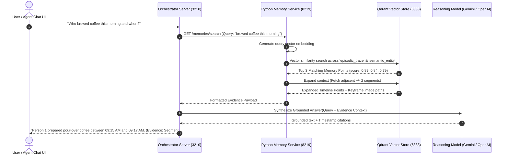

# 🏛️ ReflectWorld: High-Level Design (HLD) & Architecture

> **A Comprehensive Engineering Specification of the 11 Architectural Blocks, Multi-Tier Processing Pipelines, and Hierarchical Memory Topology.**

---

## 📌 Table of Contents
1. [End-to-End System Topology](#-end-to-end-system-topology)
2. [The 11 Architectural Blocks Breakdown](#-the-11-architectural-blocks-breakdown)
   - [Block 1: Input Layer](#block-1-input-layer)
   - [Block 2: Capture & Ingestion Engine](#block-2-capture--ingestion-engine)
   - [Block 3: Composite Segmentation Pipeline](#block-3-composite-segmentation-pipeline)
   - [Block 4: Working Memory & Context Buffer](#block-4-working-memory--context-buffer)
   - [Block 5: Dual-Tier Perception Engine](#block-5-dual-tier-perception-engine)
   - [Block 6: Entity Resolution & Re-Identification](#block-6-entity-resolution--re-identification)
   - [Block 7: Hierarchical Vector Memory System](#block-7-hierarchical-vector-memory-system)
   - [Block 8: Retrieval & Evidence QA Agent](#block-8-retrieval--evidence-qa-agent)
   - [Block 9: External AI Services Gateway](#block-9-external-ai-services-gateway)
   - [Block 10: User Interfaces & APIs](#block-10-user-interfaces--apis)
   - [Block 11: End Users & Autonomous Agents](#block-11-end-users--autonomous-agents)
3. [The 9 Qdrant Memory Collections Specification](#-the-9-qdrant-memory-collections-specification)
4. [Data Flow Sequences](#-data-flow-sequences)
   - [Flow A: Video Ingestion to Memory Write](#flow-a-video-ingestion-to-memory-write)
   - [Flow B: Agent Query & Grounded Recall](#flow-b-agent-query--grounded-recall)
5. [Process Lifecycle & Fault Tolerance](#-process-lifecycle--fault-tolerance)
6. [Cross-Link Navigation](#-cross-link-navigation)

---

## 🌐 End-to-End System Topology

The diagram below presents the authoritative High-Level Design (HLD) of ReflectWorld, detailing the interactions between ingestion, local models, Python memory microservices, and external foundation models:

```mermaid
graph TB
    subgraph B1 ["Block 1: Input Layer"]
        VS["Video Feeds<br/>(File / RTSP / Webcam / Smart Glasses)"]
        AS["Audio Streams<br/>(Embedded PCM / AAC)"]
    end
    
    subgraph B2 ["Block 2: Capture & Ingestion Engine"]
        CAM["@reflectworld/cam<br/>Ingestion Coordinator"]
        FFM["FFmpeg Runtime<br/>(1 FPS Sampling / MJPEG Pipe)"]
        G2R["go2rtc Engine<br/>(RTSP WebRTC Bridge)"]
    end
    
    subgraph B3 ["Block 3: Composite Segmentation"]
        SEG["Activity Segmenter<br/>(Adaptive Cut Evaluator)"]
        VAD["Silero VAD<br/>(Speech Activity Detector)"]
        OF["Optical Flow / Motion Filter"]
        HIST["Color Histogram Differencing"]
    end
    
    subgraph B4 ["Block 4: Working Memory & Context"]
        WMEM["Working Memory<br/>(Short-Term Segment Context)"]
        SCENE["Scene Context<br/>(Camera Patterns & Anchors)"]
        ENTITY_HIST["Entity Profile Cache<br/>(Recent Sightings)"]
        PROC_RULES["Procedural Rule Engine<br/>(User Guardrails)"]
    end

    subgraph B5 ["Block 5: Perception Engine"]
        PERCEPT["@reflectworld/percept Orchestrator"]
        subgraph L0 ["Level 0: Fast VLM"]
            VLM0["VLM Analyzer<br/>(Gemini / OpenAI Keyframe Reasoning)"]
        end
        subgraph L1_DET ["Level 1: Local Detectors"]
            YOLO["YOLO26m<br/>(Object Detection)"]
            FACE["RetinaFace<br/>(Face Landmark Detection)"]
            POSE["RTMPose<br/>(17 Keypoint Skeleton)"]
            STT["Moonshine / ElevenLabs<br/>(Speech to Text)"]
        end
        subgraph L1_REID ["Level 1: Re-Identification"]
            FACEID["ArcFace ONNX<br/>(512-dim Face Vectors)"]
            BODYID["CLIP-ReID<br/>(768-dim Appearance Vectors)"]
        end
    end

    subgraph B6 ["Block 6: Entity Resolution"]
        RESOLVER["Identity Resolver<br/>(Temporal Clique Clustering)"]
        REID_SEARCH["ReID Vector Matcher<br/>(Cosine Thresholding)"]
    end

    subgraph B7 ["Block 7: Hierarchical Memory Engine"]
        MEM_ADAPTER["@reflectworld/mem<br/>(Node.js Client Adapter)"]
        subgraph PY_MEM ["Python Memory Microservice (Port 8219)"]
            MEM_CORE["Memory Manager<br/>(FastAPI CRUD Engine)"]
            CONSOLIDATE["Consolidation Engine<br/>(Episodic ➔ Semantic Extraction)"]
        end
        subgraph STORAGE ["Persistent Storage Tier"]
            QDRANT[("Qdrant Vector Database<br/>(9 Specialized Collections)")]
            SQLITE[("SQLite Database<br/>(Metadata & Audit Logs)")]
        end
    end

    subgraph B8 ["Block 8: Retrieval & QA Agent"]
        RETRIEVAL["Hybrid Vector Search<br/>(Dense Vectors + Payload Filtering)"]
        QA["QA Reasoning Agent<br/>(Evidence Formulation)"]
        VERIFY["Evidence Grounding<br/>(Timestamp & Crop Attribution)"]
    end

    subgraph B9 ["Block 9: External AI Providers"]
        VLM_API["Vision-Language APIs<br/>(Gemini 3.1 Flash / GPT-4o)"]
        EMBED_API["Vector Embedder<br/>(text-embedding-004 / OpenAI)"]
    end

    subgraph B10 ["Block 10: Interfaces & Presentation"]
        DASHBOARD["React 19 Dashboard<br/>(Port 3210 - Timeline & Moments)"]
        REST_API["HTTP REST API Endpoints"]
        WS["WebSocket Event Gateway<br/>(Real-Time Stream Pushes)"]
        OPENCLAW["OpenClaw Agent Plugin"]
    end

    subgraph B11 ["Block 11: Consumers"]
        USER["Human Operators & Observers"]
        AGENT["Autonomous AI Agent Clients"]
    end

    %% Wiring & Edges
    VS --> CAM
    AS --> CAM
    CAM --> G2R
    CAM --> FFM
    FFM --> OF
    FFM --> HIST
    AS --> VAD
    VAD --> SEG
    OF --> SEG
    HIST --> SEG
    
    SEG -->|Segment Trigger (Keyframes)| PERCEPT
    PERCEPT --> VLM0
    PERCEPT --> YOLO
    PERCEPT --> FACE
    PERCEPT --> POSE
    PERCEPT --> STT
    
    FACE --> FACEID
    POSE --> BODYID
    FACEID --> RESOLVER
    BODYID --> RESOLVER
    RESOLVER <--> REID_SEARCH
    
    PERCEPT <--> WMEM
    WMEM --- SCENE
    WMEM --- ENTITY_HIST
    WMEM --- PROC_RULES
    
    VLM0 <--> VLM_API
    RESOLVER -->|Resolved Narrative & Entities| MEM_ADAPTER
    MEM_ADAPTER --> MEM_CORE
    MEM_CORE --> CONSOLIDATE
    MEM_CORE --> QDRANT
    MEM_CORE --> SQLITE
    CONSOLIDATE <--> EMBED_API
    
    QDRANT <--> RETRIEVAL
    RETRIEVAL --> QA
    QA --> VERIFY
    VERIFY --> DASHBOARD
    
    MEM_CORE --> WS
    WS --> DASHBOARD
    REST_API --> DASHBOARD
    DASHBOARD --> USER
    QA --> AGENT
    OPENCLAW --> AGENT

    style B1 fill:#EBF5FB,stroke:#2980B9,stroke-width:2px;
    style B2 fill:#E8F8F5,stroke:#16A085,stroke-width:2px;
    style B3 fill:#FEF9E7,stroke:#F39C12,stroke-width:2px;
    style B4 fill:#FADBD8,stroke:#C0392B,stroke-width:2px;
    style B5 fill:#F4ECF7,stroke:#8E44AD,stroke-width:2px;
    style B6 fill:#F5EEF8,stroke:#9B59B6,stroke-width:2px;
    style B7 fill:#EAFAF1,stroke:#27AE60,stroke-width:2px;
    style B8 fill:#EAF2F8,stroke:#3498DB,stroke-width:2px;
    style B9 fill:#FCF3CF,stroke:#D4AC0D,stroke-width:2px;
    style B10 fill:#EBEDEF,stroke:#34495E,stroke-width:2px;
    style B11 fill:#EDBB99,stroke:#D35400,stroke-width:2px;
```

---

## 🧩 The 11 Architectural Blocks Breakdown

### Block 1: Input Layer
The entry interface for visual and auditory streams. ReflectWorld abstracts varied media inputs into a unified stream format:
* **Pre-recorded Local Files:** `.mp4`, `.mkv`, `.avi` uploaded via the dashboard or queued via CLI.
* **Live Network Streams:** RTSP cameras (Hikvision, Dahua, Axis), RTMP, and HLS broadcast links.
* **Physical Hardware:** Direct USB webcams, camera mounts, and wearable recording glasses (Meta Ray-Ban).
* **Audio Transports:** Synchronized PCM/AAC tracks extracted simultaneously with video frames.

### Block 2: Capture & Ingestion Engine
Located in [`packages/cam`](file:///c:/Users/DELL/Desktop/Mega%20Project%20folder/ReflectWorld/packages/cam):
* **FFmpeg Process Pipeline:** Spawns isolated worker processes to sample streams at a deterministic 1 FPS rate without unneeded re-encoding.
* **Modern Framerate Control:** Uses `-fps_mode vfr` and image-to-pipe stream multiplexing to prevent frame duplication.
* **`go2rtc` RTSP Gateway:** An ultra-low-latency WebRTC/RTSP relay that restructures live camera feeds for browser playback while multiplexing raw frame delivery to the segmenter.

### Block 3: Composite Segmentation Pipeline
Rather than dividing video blindly by fixed time intervals (e.g. every 10 seconds), ReflectWorld cuts video at **natural event boundaries**:
* **Voice Activity Detection (Silero VAD):** Tracks speech intervals. A voice pause ($\ge 350\text{ ms}$) triggers an adaptive split (`voice_pause_adaptive`).
* **Visual Scene Cut (Histogram Differencing):** Evaluates color channel distribution changes across frames to detect camera switches or lighting changes.
* **Motion Energy Delta (Optical Flow):** Analyzes pixel vector velocity. When a sudden physical action ends, a segment boundary is declared.
* **Keyframe Selection:** Extracts exactly 3–5 representative frames per segment:
  1. *Anchor Frame*: The starting baseline.
  2. *Peak Action Frame*: Frame with maximum pixel delta.
  3. *Concluding Frame*: Final state of the moment.

### Block 4: Working Memory & Context Buffer
Maintains live operational state before committing long-term vector records:
* **Rolling Temporal Buffer:** Keeps the last 18 segment summaries in memory for narrative continuity.
* **Scene Patterns:** Tracks environmental anchor points (e.g. "Kitchen Counter", "Office Desk").
* **Procedural Rules:** Injects user-specified guidelines (e.g. *"Alert if an unknown person remains in the room for > 5 minutes"*).

### Block 5: Dual-Tier Perception Engine
Located in [`packages/percept`](file:///c:/Users/DELL/Desktop/Mega%20Project%20folder/ReflectWorld/packages/percept):
* **Level 0 (Cloud VLM Inference):**
  - Sends extracted keyframes directly to a Vision-Language Model (Gemini 3.1 Flash / GPT-4o-mini).
  - Prompts are dynamically structured using `prompt-builder.ts` to output clean JSON schemas containing moment titles, visual summaries, observed objects, and implied actions.
* **Level 1 (Deep Local Edge Perception):**
  - **YOLO26m ONNX:** Identifies bounding boxes for 80+ object classes.
  - **RetinaFace ONNX:** Detects high-precision facial boundaries and 5-point facial landmarks.
  - **ArcFace / AdaFace ONNX:** Converts cropped face bounding boxes into 512-dimensional normalized facial vectors.
  - **RTMPose ONNX:** Extracts 17 body keypoint skeletons for human posture and activity classification.
  - **Moonshine / ElevenLabs STT:** Transcribes spoken audio, providing synchronized dialogue transcripts.

### Block 6: Entity Resolution & Re-Identification
Located in [`packages/percept/src/identity-resolver.ts`](file:///c:/Users/DELL/Desktop/Mega%20Project%20folder/ReflectWorld/packages/percept/src/identity-resolver.ts):
* **Face Embedding Matching:** Compares incoming face vectors against Qdrant's `reid_face` collection using Cosine Similarity ($\text{threshold} \ge 0.65$).
* **Appearance Continuity:** When faces are occluded or turned, body descriptors (`CLIP-ReID`) maintain identity continuity.
* **Temporal Association:** Resolves ambiguous sightings by evaluating spatial proximity and appearance consistency across consecutive segments.
* **Identity Clustering:** Merges anonymous observations into persistent profiles (`person_1`, `person_2`), recording historical sighting counts, timestamps, and locations.

### Block 7: Hierarchical Vector Memory System
Located in [`services/mem`](file:///c:/Users/DELL/Desktop/Mega%20Project%20folder/ReflectWorld/services/mem):
* Implemented as an independent, high-performance Python FastAPI service communicating over HTTP port `8219`.
* Manages **9 distinct Qdrant vector collections**, separating high-frequency raw moment observations from consolidated long-term facts.
* Contains a background **Consolidation Engine**: When multiple episodic sightings occur for an entity, it summarizes raw sightings into permanent semantic traits (e.g., *"Person 1 visits daily between 9 AM and 10 AM"*).

### Block 8: Retrieval & Evidence QA Agent
* **Hybrid Search Strategy:** Combines vector semantic similarity (dense embeddings) with metadata payload filtering (e.g. `camera_id`, `entity_id`, timestamp ranges).
* **Timeline Expansion:** When an anchor moment is retrieved, the engine fetches adjacent preceding and succeeding segments ($\pm 2\text{ moments}$) to recover context.
* **Evidence Grounding:** Every answer returned by the QA agent is cited with:
  - Exact video timestamps ($T_{\text{start}}$ to $T_{\text{end}}$).
  - Stored visual keyframe images.
  - Transcribed dialogue lines.

### Block 9: External AI Services Gateway
* **Resilient VLM Transport (`transport.ts`):** Handles automatic retries with exponential backoff and jitter (`VLM_MAX_RETRIES=4`, base delay `1500 ms`).
* **Provider Abstraction:** Seamlessly switches between Google Gemini (`gemini-3.1-flash`, `gemini-3.8-flash`) and OpenAI endpoints (`gpt-4o-mini`, `text-embedding-3-small`).
* **Frame Optimization:** Dynamic image downscaling (`VLM_FRAME_RESIZE_ENABLED=true`) reduces token payload sizes and network latency by 60%.

### Block 10: User Interfaces & APIs
* **React 19 Single Page Dashboard:** Built with Vite and TailwindCSS on port `3210`. Features an interactive video player, real-time moment feed, entity inspector, and evidence viewer.
* **WebSocket Event Gateway:** Emits real-time state mutations (`segment_created`, `entity_resolved`, `memory_consolidated`).
* **OpenClaw Plugin Interface:** Exposes the entire video memory layer as standardized agent tools compatible with external autonomous agent frameworks.

### Block 11: End Users & Autonomous Agents
* **Human Operators:** Review live premises, audit memory summaries, edit entity nicknames, and chat with historical video memory.
* **Autonomous Agents:** Use ReflectWorld as their persistent visual cortex to reason about the physical world.

---

## 🗄️ The 9 Qdrant Memory Collections Specification

ReflectWorld structures its memory hierarchy across 9 specialized collections in Qdrant:

```
┌────────────────────────────────────────────────────────────────────────┐
│                      QDRANT VECTOR STORE TOPOLOGY                      │
├────────────────────────────────────────────────────────────────────────┤
│  EPISODIC MEMORY (Temporal Observations)                               │
│  ├── 1. episodic_trace   (1536-dim): Segment-level narrative summaries│
│  ├── 2. episodic_entity  (1536-dim): Segment-level per-entity actions │
│  ├── 3. episodic_schema  (1536-dim): Multi-segment chapter summaries   │
│  └── 4. episodic_visual  (1024-dim): Reserved video frame embeddings   │
├────────────────────────────────────────────────────────────────────────┤
│  SEMANTIC MEMORY (Consolidated World Knowledge)                        │
│  ├── 5. semantic_entity  (1536-dim): Consolidated entity biographies   │
│  └── 6. semantic_context (1536-dim): Camera-level scene habits & rules │
├────────────────────────────────────────────────────────────────────────┤
│  PROCEDURAL MEMORY (Rules & Guardrails)                                │
│  └── 7. procedural       (1536-dim): Safety checks & monitoring rules  │
├────────────────────────────────────────────────────────────────────────┤
│  RE-IDENTIFICATION (Biometric & Visual Vectors)                        │
│  ├── 8. reid_face        ( 512-dim): Normalized ArcFace embeddings     │
│  └── 9. reid_entity      ( 768-dim): CLIP-ReID body appearance vectors │
└────────────────────────────────────────────────────────────────────────┘
```

### Detailed Collection Schema:

| Collection Name | Vector Dims | Metric | Purpose & Indexed Payload |
| :--- | :---: | :---: | :--- |
| `episodic_trace` | 1536 | Cosine | Individual video moments. Payload: `camera_id`, `start_ts`, `end_ts`, `summary`, `action_tags`, `keyframe_paths`. |
| `episodic_entity` | 1536 | Cosine | Specific actions performed by an entity during a moment. Payload: `entity_id`, `camera_id`, `activity`, `timestamp`. |
| `episodic_schema` | 1536 | Cosine | High-level chapter milestones (groupings of 5–10 moments). Payload: `chapter_title`, `narrative_arc`, `duration`. |
| `episodic_visual` | 1024 | Cosine | Visual vector representations of keyframes for zero-shot visual retrieval. |
| `semantic_entity` | 1536 | Cosine | Long-term identity profiles. Payload: `entity_id`, `first_seen`, `total_sightings`, `habit_summary`, `roles`. |
| `semantic_context` | 1536 | Cosine | Learned spatial knowledge of a camera viewpoint (e.g. typical occupancy hours, room layout). |
| `procedural` | 1536 | Cosine | User-defined rules and triggers (e.g., *"Notify if the kitchen is left unattended with stove on"*). |
| `reid_face` | 512 | Cosine | Deep facial feature embeddings. Payload: `entity_id`, `segment_id`, `bounding_box`, `face_quality_score`. |
| `reid_entity` | 768 | Cosine | Full-body visual embeddings for cross-camera re-identification when faces are not visible. |

---

## 🔁 Data Flow Sequences

### Flow A: Video Ingestion to Memory Write

```mermaid
sequenceDiagram
    autonumber
    actor Cam as Video Ingestion (FFmpeg / go2rtc)
    participant Seg as Composite Segmenter
    participant Percept as Perception Orchestrator
    participant VLM as Gemini / OpenAI Gateway
    participant Resolver as Identity Resolver
    participant PyMem as Python Memory Service (8219)
    participant Qdrant as Qdrant Vector Store (6333)

    Cam->>Seg: Stream 1 FPS frames + audio PCM
    Seg->>Seg: Detect VAD pause or motion delta
    Seg->>Percept: Dispatch Segment (Keyframes + Audio Chunks)
    
    par Dual Perception
        Percept->>VLM: Request Visual Summary (Keyframes)
        VLM-->>Percept: JSON: { title, summary, actions, objects }
    and Level 1 Local Inference (If enabled)
        Percept->>Percept: Run RetinaFace & ArcFace ONNX
        Percept->>Resolver: Match 512-dim Face Vectors
        Resolver<->Qdrant: Query reid_face collection (Cosine >= 0.65)
        Resolver-->>Percept: Resolved Entity ID (e.g. 'person_1')
    end

    Percept->>PyMem: POST /memories (Segment Data + Entity Anchors)
    PyMem->>PyMem: Generate text-embedding-004 vector (1536-dim)
    PyMem->>Qdrant: Upsert to 'episodic_trace' & 'episodic_entity'
    PyMem-->>Percept: 200 OK (Memory Point Created)
    Percept->>Cam: Update Rolling Working Memory Buffer
```

---

### Flow B: Agent Query & Grounded Recall



---

## 🛡️ Process Lifecycle & Fault Tolerance

```
┌────────────────────────────────────────────────────────────────────────┐
│                     SUBSYSTEM RESILIENCE STRATEGY                      │
├───────────────────────┬────────────────────────────────────────────────┤
│ Subsystem             │ Recovery & Handling Behavior                   │
├───────────────────────┼────────────────────────────────────────────────┤
│ **Qdrant Storage**    │ • Managed or external mode auto-detection.     │
│                       │ • Auto-recreates missing collections on boot.  │
│                       │ • On restart, verifies dimensions & payload    │
│                       │   indexes without data loss.                   │
├───────────────────────┼────────────────────────────────────────────────┤
│ **Memory Service**    │ • Python service auto-reconnects on Qdrant     │
│                       │   disconnect.                                  │
│                       │ • Embedder fallback: returns safe zero-vector  │
│                       │   if cloud embedding API times out.            │
├───────────────────────┼────────────────────────────────────────────────┤
│ **VLM Provider**      │ • Exponential backoff with jitter on 429/503.  │
│                       │ • Downscales images before dispatch to prevent │
│                       │   payload timeouts.                            │
├───────────────────────┼────────────────────────────────────────────────┤
│ **FFmpeg Ingestion**  │ • Uses `-fps_mode vfr` to avoid frame drops.   │
│                       │ • Watchdog worker auto-restarts broken RTSP    │
│                       │   streams within 1000ms.                       │
└───────────────────────┴────────────────────────────────────────────────┘
```

---

## 🧭 Cross-Link Navigation

* 📖 **[Phase 1: Project Overview & Vision](file:///c:/Users/DELL/Desktop/Mega%20Project%20folder/docs/01_PROJECT_OVERVIEW.md)** — Core problem statement, benchmark analysis, and research foundations.
* 🏗️ **[Phase 2: High-Level Design & System Architecture](file:///c:/Users/DELL/Desktop/Mega%20Project%20folder/docs/02_HIGH_LEVEL_DESIGN.md)** *(You are here)*
* 💻 **[Phase 3: Codebase & Monorepo Architecture](file:///c:/Users/DELL/Desktop/Mega%20Project%20folder/docs/03_CODEBASE_ARCHITECTURE.md)** — Monorepo directory map, package responsibilities, and configuration dictionary.
* 🔍 **[Phase 4: Feature-Wise Working & Code Walkthrough](file:///c:/Users/DELL/Desktop/Mega%20Project%20folder/docs/04_FEATURE_DEEP_DIVE.md)** — Deep dive into the mathematical algorithms for VAD, Re-ID cosine matching, and timeline expansion.
