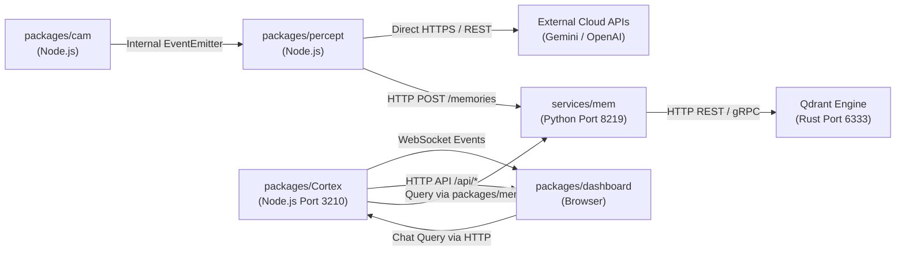

# 💻 Cortex: Codebase Architecture & Monorepo Guide

> **An Exhaustive Code-Level Reference Guide Covering Monorepo Topology, Package Boundaries, Inter-Process Communication, and Environment Configuration.**

---

## 📌 Table of Contents
1. [Monorepo Architecture Overview](#-monorepo-architecture-overview)
2. [Root Directory & Workspace Layout](#-root-directory--workspace-layout)
3. [Deep Dive: Package by Package](#-deep-dive-package-by-package)
   - [`packages/cam` — Ingestion & Video Processing](#1-packagescam--ingestion--video-processing)
   - [`packages/percept` — Dual-Tier Perception & Identity Resolution](#2-packagespercept--dual-tier-perception--identity-resolution)
   - [`services/mem` (Python) — Vector Memory Microservice](#3-servicesmem-python--vector-memory-microservice)
   - [`packages/mem` (TypeScript) — Node.js Client & Type Contracts](#4-packagesmem-typescript--nodejs-client--type-contracts)
   - [`packages/Cortex` — Core CLI & Orchestrator](#5-packagesCortex--core-cli--orchestrator)
   - [`packages/dashboard` — React 19 Frontend Workspace](#6-packagesdashboard--react-19-frontend-workspace)
   - [`packages/host` — Standalone Demo & Static Servers](#7-packageshost--standalone-demo--static-servers)
   - [`packages/shared` — Common Types, Events & Utilities](#8-packagesshared--common-types-events--utilities)
4. [Inter-Process Communication (IPC) & Communication Matrix](#-inter-process-communication-ipc--communication-matrix)
5. [Complete Environment Configuration Dictionary (`.env`)](#-complete-environment-configuration-dictionary-env)
6. [Development, Build & Release Workflows](#-development-build--release-workflows)
7. [Cross-Link Navigation](#-cross-link-navigation)

---

## 🏗️ Monorepo Architecture Overview

Cortex is organized as a **hybrid TypeScript + Python monorepo**. It pairs TypeScript's robust type safety and asynchronous event loop for media streaming with Python's deep-learning and vector mathematics ecosystem:

```
┌────────────────────────────────────────────────────────────────────────┐
│                      Cortex MONOREPO ECOSYSTEM                   │
├────────────────────────────────────────────────────────────────────────┤
│  TYPESCRIPT WORKSPACE (npm workspaces / Node.js >= 22)                 │
│  ├── packages/cam         ──► Ingestion, FFmpeg & Silero VAD           │
│  ├── packages/percept     ──► Dual-tier VLM + ONNX Detection Pipeline  │
│  ├── packages/mem         ──► TypeScript SDK for Memory Microservice   │
│  ├── packages/Cortex──► Core Orchestrator, CLI & Self-Check      │
│  ├── packages/dashboard   ──► React 19 + Vite Interactive Web App      │
│  ├── packages/host        ──► Standalone Demo Host & Mock Servers      │
│  └── packages/shared      ──► Cross-package Event Bus & Type Contracts │
├────────────────────────────────────────────────────────────────────────┤
│  PYTHON MICROSERVICES (Python >= 3.11 / FastAPI / Qdrant)              │
│  └── services/mem         ──► 9-Collection Memory Engine (Port 8219)   │
├────────────────────────────────────────────────────────────────────────┤
│  NATIVE RUNTIMES & ASSETS                                              │
│  ├── C:\qdrant\qdrant.exe ──► High-performance Vector Store (Port 6333)│
│  └── ~/.Cortex/bin/ ──► Local FFmpeg, ffprobe, go2rtc binaries   │
└────────────────────────────────────────────────────────────────────────┘
```

---

## 📂 Root Directory & Workspace Layout

```
Cortex/
├── .env                       # Local configuration (API keys, ports, model names)
├── .env.example               # Template environment variables
├── package.json               # Root workspace manager & build scripts
├── tsconfig.base.json         # Base TypeScript compiler configuration
├── tsconfig.json              # Project solution TypeScript config
├── vitest.config.ts           # Root test configuration
├── scripts/
│   ├── bundle-assets.js       # Bundles dashboard and python service for distribution
│   └── release.js             # Automated npm release pipeline
├── eval/                      # Benchmark evaluation suite
│   ├── benchmark/             # VideoMME, EgoSchema, M3-Bench harness scripts
│   └── video-runner/          # Headless benchmark execution engine
├── packages/                  # TypeScript packages
│   ├── cam/                   # Media capture & segmentation
│   ├── percept/               # AI perception & entity resolution
│   ├── mem/                   # Memory client bindings
│   ├── Cortex/          # CLI, orchestrator & VisionController
│   ├── dashboard/             # React 19 frontend
│   ├── host/                  # Demo server & mock harness
│   └── shared/                # Shared interfaces, events & loggers
└── services/
    └── mem/                   # Python FastAPI hierarchical memory microservice
```

---

## 🔍 Deep Dive: Package by Package

---

### 1. `packages/cam` — Ingestion & Video Processing
* **Role:** Ingests raw video/audio feeds, extracts frames, detects voice activity, and computes segment boundaries.
* **Core Technology:** FFmpeg process pipes, Silero VAD ONNX model, `go2rtc` daemon.

```
packages/cam/src/
├── local-file-media-source.ts   # Core engine for processing uploaded MP4 files
├── live-media-source.ts         # RTSP and WebRTC stream consumer
├── frame-extractor.ts           # Spawns FFmpeg worker with `-fps_mode vfr`
├── audio-extractor.ts           # Extracts 16kHz mono PCM for audio intelligence
├── silero-vad.ts                # Voice Activity Detector using Silero ONNX
├── segment-builder.ts           # Builds and accumulates finalized video segments
├── go2rtc-manager.ts            # Manages lifecycle of go2rtc streaming daemon
├── binary-installer.ts          # Resolves and verifies ffmpeg/ffprobe/go2rtc paths
└── segmenter/
    ├── composite.ts             # Multimodal segmentation evaluator (VAD + motion)
    ├── motion-detector.ts       # Frame-to-frame optical flow & pixel delta
    └── scene-detector.ts        # Color histogram differencing
```

#### Key Implementation Details:
* **`local-file-media-source.ts`**: Implements backpressure-aware frame consumption. It streams raw MJPEG images from FFmpeg's `stdout` (FD 1) and raw 16kHz PCM audio from FD 3 without creating intermediate disk files.
* **`segmenter/composite.ts`**: Evaluates 3 trigger signals in real time:
  $$\text{Cut Condition} = (\text{VAD Speech Pause} \ge 350\text{ms}) \lor (\Delta_{\text{motion}} \ge \theta_{\text{motion}}) \lor (\Delta_{\text{histogram}} \ge \theta_{\text{hist}})$$

---

### 2. `packages/percept` — Dual-Tier Perception & Identity Resolution
* **Role:** Analyzes keyframe imagery, extracts visual semantics, runs local computer-vision models, and resolves persistent entity identities.
* **Core Technology:** ONNX Runtime (`onnxruntime-node`), Google Gemini API, OpenAI API.

```
packages/percept/src/
├── pipeline.ts                  # Master perception pipeline coordinator
├── identity-resolver.ts         # Cross-segment entity linking & Re-ID engine
├── working-memory.ts            # Short-term buffer of ongoing events
├── semantic-context.ts          # Scene patterns & camera-level memory
├── frame-analyzer.ts            # Dispatches frames to active analyzers
├── thresholds.ts                # Mathematical confidence & similarity cutoffs
├── analyzers/
│   ├── vlm-analyzer.ts          # Orchestrator for foundation models
│   ├── yolo26.ts                # YOLO26m ONNX object detector
│   ├── retinaface.ts            # RetinaFace ONNX face detector & landmarker
│   ├── adaface.ts / arcface.ts  # 512-dim face Re-ID embedding extractor
│   ├── rtmpose.ts               # 17-keypoint skeleton pose estimator
│   ├── clip-reid.ts             # 768-dim body appearance Re-ID
│   └── elevenlabs-stt.ts        # Speech-to-text transcript analyzer
└── vlm-analyzer/
    ├── transport.ts             # Resilient HTTP transport with retries & backoff
    ├── prompt-builder.ts        # Structured JSON prompt generator
    └── prompts.ts               # Specialized prompts for visual reasoning
```

#### Key Implementation Details:
* **`identity-resolver.ts`**: Maintains the entity registry. When a face is detected:
  1. Computes the 512-dimensional normalized embedding vector $\vec{f}$.
  2. Searches Qdrant's `reid_face` collection:
     $$\text{Cosine Similarity} = \frac{\vec{f} \cdot \vec{f}_{\text{stored}}}{\|\vec{f}\| \|\vec{f}_{\text{stored}}\|}$$
  3. If $\text{sim} \ge 0.65$, re-associates the sighting with the existing entity; otherwise, registers a new profile (`person_N`).
* **`vlm-analyzer/transport.ts`**: Wraps external API requests with robust fault tolerance, handling network timeouts, payload resizing (`vlm_frame_resize_enabled`), and HTTP 429/503 exponential backoff.

---

### 3. `services/mem` (Python) — Vector Memory Microservice
* **Role:** Standalone FastAPI microservice providing hierarchical vector memory management, semantic search, and memory consolidation.
* **Core Technology:** Python 3.11, FastAPI, Uvicorn, Qdrant Client, Google Generative AI / OpenAI SDK.

```
services/mem/
├── pyproject.toml               # Python dependencies and build metadata
├── uv.lock                      # Deterministic dependency lockfile
└── src/
    ├── main.py                  # FastAPI application & REST endpoint definitions
    ├── config.py                # Environment configuration loader (.env)
    ├── qdrant_store.py          # Wrapper for the 9 Qdrant vector collections
    ├── memory_manager.py        # Core memory orchestration & CRUD algorithms
    ├── embedder.py              # Text embedding provider (Gemini / OpenAI fallback)
    ├── llm.py                   # Multi-provider text LLM client
    ├── reid.py                  # Re-ID vector indexing & gallery manager
    ├── history.py               # SQLite audit history logger
    └── prompts.py               # Consolidation and summarization prompts
```

#### Key Implementation Details:
* **`qdrant_store.py`**: Automatically provisions all 9 collections on startup. Configures HNSW vector indexes and creates fast payload indexes on fields like `camera_id`, `entity_id`, and `timestamp`.
* **`memory_manager.py`**: Executes timeline expansion. When an anchor memory point is retrieved via cosine search, it queries preceding and subsequent points using `start_ts` ranges to reconstruct continuous scene context.

---

### 4. `packages/mem` (TypeScript) — Node.js Client & Type Contracts
* **Role:** Lightweight client SDK used by TypeScript packages to talk to the Python memory microservice over HTTP.
* **Core Files:**
  - `client.ts`: Exposes typed methods (`createMemory()`, `searchMemories()`, `reidSearch()`, `getMemoryHistory()`).
  - `types.ts`: TypeScript interfaces representing the 9 memory models, query filters, and search response structures.

---

### 5. `packages/Cortex` — Core CLI & Orchestrator
* **Role:** The central system daemon and command-line interface. Coordinates all other packages, launches background services, and manages lifecycle events.
* **Core Files:**
  - `src/cli/index.ts`: CLI entry point (`start`, `setup`, `enable-level1`).
  - `src/cli/setup.ts`: Automated setup installer (downloads models, sets up binaries).
  - `src/services/qdrant-service.ts`: Manages the Qdrant database process lifecycle.
  - `src/services/dashboard-server.ts`: Dashboard API backend routes.
  - `src/vision-controller/`: Rule engine evaluating alerts and active perception depth.
  - `index.ts`: Pipeline self-check mechanism verifying system health on startup.

---

### 6. `packages/dashboard` — React 19 Frontend Workspace
* **Role:** Modern, real-time web application for inspecting streams, moments, entities, and memories.
* **Core Technology:** React 19, Vite, TailwindCSS, Lucide Icons.

```
packages/dashboard/src/
├── App.tsx                      # Root application layout & state coordinator
├── components/
│   ├── VideoPlayer.tsx          # Real-time WebRTC / video playback
│   ├── MomentsTimeline.tsx      # Chronological moment feed with keyframes
│   ├── EntityInspector.tsx      # Person & object profiles with sighting counts
│   ├── MemoryExplorer.tsx       # 9-collection Qdrant visual database viewer
│   └── ChatDrawer.tsx           # Grounded evidence recall assistant
├── hooks/
│   ├── useWebSocket.ts          # Real-time event listener for live mutations
│   └── useSources.ts            # Camera and video feed manager
└── state/                       # Global state stores & persistence
```

---

### 7. `packages/host` — Standalone Demo & Static Servers
* **Role:** Provides standalone hosting and mock server implementations for running the system in demo or testing environments without external dependencies.
* **Core Files:**
  - `demo-server.ts`: Mock host providing pre-canned segment timelines and entity profiles.
  - `server.ts`: Production host wiring the real plugin services to HTTP ports 3210 / 3211.
  - `ws-server.ts`: WebSocket broadcast hub.

---

### 8. `packages/shared` — Common Types, Events & Utilities
* **Role:** Zero-dependency contract library shared across all TypeScript packages.
* **Core Files:**
  - `types.ts`: Global data models (`Segment`, `PerceptionMemory`, `EntityRecord`, `VideoFrame`).
  - `events.ts`: Event definitions emitted over the internal event bus and WebSocket.
  - `paths.ts`: Cross-platform filesystem path resolver (`~/.Cortex/`).

---

## 🔌 Inter-Process Communication (IPC) & Communication Matrix

The table below outlines how data flows across process boundaries in Cortex:



| Source Process | Target Process | Protocol | Port / Channel | Data Exchanged |
| :--- | :--- | :---: | :---: | :--- |
| `packages/cam` | FFmpeg Binary | Process Pipe | Stdout / Stderr | Raw MJPEG image stream (FD 1), PCM audio (FD 3) |
| `packages/cam` | `packages/percept` | In-Process EventBus | Memory Pointer | Finalized `Segment` objects containing keyframe buffers |
| `packages/percept` | Gemini / OpenAI | HTTPS REST | External 443 | Compressed base64 keyframes $\rightarrow$ Structured JSON summaries |
| `packages/percept` | `services/mem` | HTTP REST | Port `8219` | Memory write requests (`POST /memories`, `POST /reid/search`) |
| `services/mem` | Qdrant Database | HTTP REST / gRPC | Port `6333` / `6334` | Vector upserts, scroll queries, and payload filters |
| `packages/Cortex` | Browser Dashboard | HTTP & WebSocket | Port `3210` | Static Vite bundle, REST endpoints, real-time event updates |

---

## ⚙️ Complete Environment Configuration Dictionary (`.env`)

Below is the definitive reference for all configuration options supported by Cortex:

### 1. Vision & Foundation Model (VLM / LLM) Settings
| Variable | Allowed Values | Default | Description |
| :--- | :--- | :--- | :--- |
| `VLM_PROVIDER` | `gemini` \| `openai` | `gemini` | The primary provider for keyframe scene reasoning. |
| `VLM_API_KEY` | string | `""` | API key for the chosen VLM provider. |
| `VLM_MODEL` | string | `gemini-3.1-flash-lite` | Primary vision model for multi-frame segment analysis. |
| `VLM_MODEL_LITE` | string | `gemini-3.1-flash-lite` | Lightweight model for single-frame snapshots. |
| `LLM_MODEL` | string | `gemini-3.1-flash-lite` | Model used for narrative compression and memory consolidation. |
| `QA_MODEL` | string | `gemini-3.1-flash-lite` | Model used for answering user chat recall questions. |
| `VLM_MAX_RETRIES` | integer | `4` | Number of automatic retries on rate limits (429/503). |
| `VLM_RETRY_BASE_DELAY_MS`| integer | `1500` | Initial exponential backoff delay in milliseconds. |
| `VLM_FRAME_RESIZE_ENABLED`| `true` \| `false` | `true` | Downscales frames to 432px short-edge before API upload (speeds up VLM by 60%). |

### 2. Infrastructure & Service Ports
| Variable | Allowed Values | Default | Description |
| :--- | :--- | :--- | :--- |
| `PORT` | integer | `3210` | HTTP port for the Host daemon and React Dashboard. |
| `Cortex_ENDPOINT` | URL | `http://127.0.0.1:8219` | Network address of the Python memory service. |
| `Cortex_MEM_PORT`| integer | `8219` | Port on which the Python FastAPI service listens. |
| `QDRANT_HOST` | string | `127.0.0.1` | Hostname/IP address of the Qdrant vector database. |
| `QDRANT_PORT` | integer | `6333` | REST HTTP port for Qdrant. |
| `QDRANT_URL` | URL | `""` | Optional: Full URL for Qdrant Cloud clusters. |
| `QDRANT_API_KEY` | string | `""` | Optional: API key for Qdrant Cloud. |

### 3. Perception & Inference Level
| Variable | Allowed Values | Default | Description |
| :--- | :--- | :--- | :--- |
| `STUBS_ONLY` | `true` \| `false` | `true` | Set `true` for **Level 0 (Cloud VLM only)**; set `false` for **Level 1 (Deep Local CV models)**. |
| `COLLECTION_PREFIX` | string | `visionmem_me_production` | Namespace prefix for all 9 collections in Qdrant. |

### 4. Vector Embeddings (Optional Override)
| Variable | Allowed Values | Default | Description |
| :--- | :--- | :--- | :--- |
| `EMBEDDER_PROVIDER` | `gemini` \| `openai` | `gemini` | Embeddings provider. Defaults to Gemini `text-embedding-004`. |
| `EMBEDDING_DIMS` | integer | `1536` | Vector dimensionality matching Qdrant schema specs. |

---

## 🛠️ Development, Build & Release Workflows

### 1. Initial Installation
```bash
# Clone the repository
git clone https://github.com/your-username/Cortex.git
cd Cortex

# Install root dependencies and link monorepo workspaces
npm install

# Setup Python virtual environment for memory service
cd services/mem
py -3.11 -m venv .venv
.\.venv\Scripts\Activate.ps1
pip install -r <(echo "fastapi uvicorn qdrant-client google-generativeai python-dotenv httpx pydantic numpy")
cd ../..
```

### 2. Build Pipeline
```bash
# Compile all TypeScript workspaces
npx tsc --build

# Bundle the React dashboard and package assets
node scripts/bundle-assets.js
```

### 3. Testing Suite
```bash
# Run unit tests across all packages via Vitest
npm test

# Run tests in watch mode during development
npm run test:watch
```

---

## 🧭 Cross-Link Navigation

* 📖 **[Phase 1: Project Overview & Vision](file:///c:/Users/DELL/Desktop/Mega%20Project%20folder/docs/01_PROJECT_OVERVIEW.md)** — Core problem statement, benchmark analysis, and research foundations.
* 🏗️ **[Phase 2: High-Level Design & System Architecture](file:///c:/Users/DELL/Desktop/Mega%20Project%20folder/docs/02_HIGH_LEVEL_DESIGN.md)** — Detailed 11-block HLD breakdown, sequence diagrams, and Qdrant storage schemas.
* 💻 **[Phase 3: Codebase & Monorepo Architecture](file:///c:/Users/DELL/Desktop/Mega%20Project%20folder/docs/03_CODEBASE_ARCHITECTURE.md)** *(You are here)*
* 🔍 **[Phase 4: Feature-Wise Working & Code Walkthrough](file:///c:/Users/DELL/Desktop/Mega%20Project%20folder/docs/04_FEATURE_DEEP_DIVE.md)** — Deep dive into the mathematical algorithms for VAD, Re-ID cosine matching, and timeline expansion.
