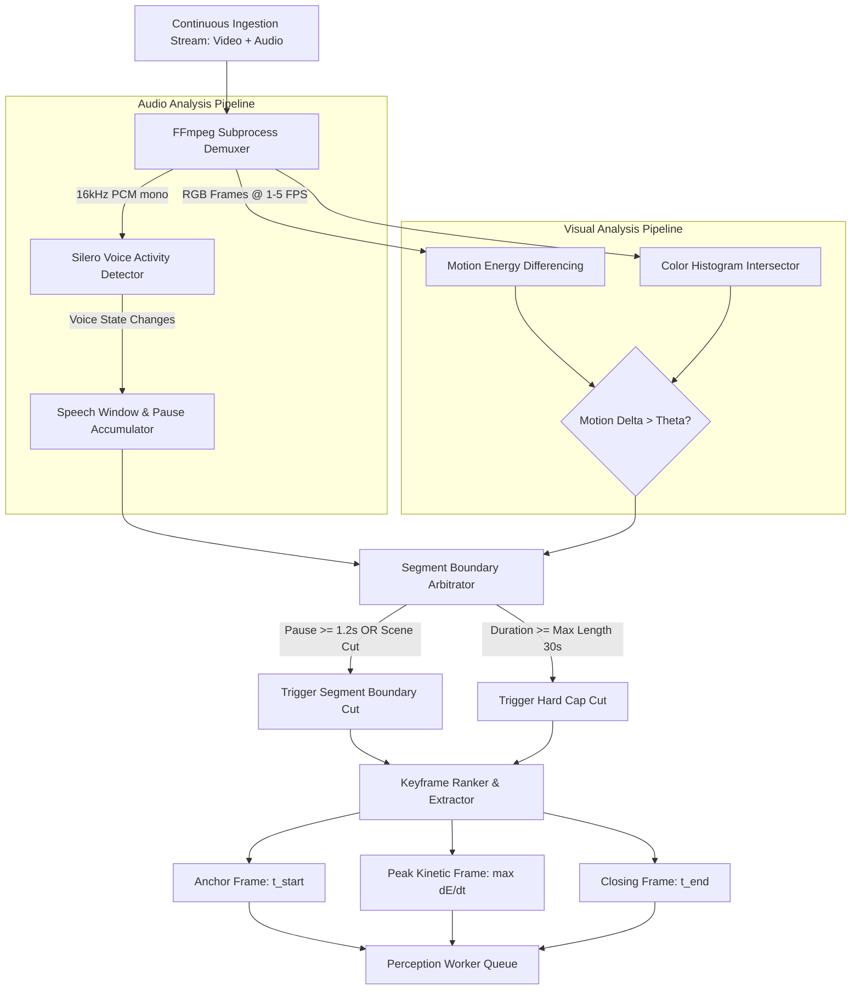
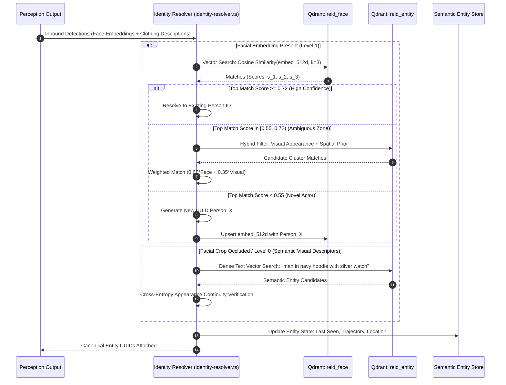
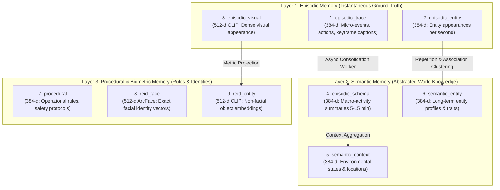
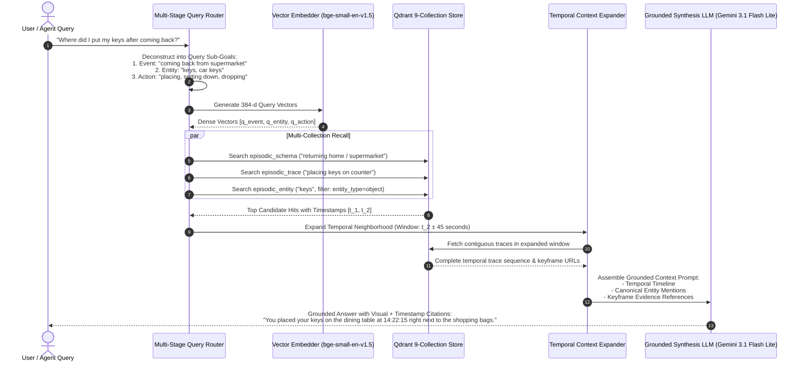

# Cortex Feature Deep Dive & Implementation Manual

Welcome to **Phase 4** of the Cortex architectural documentation suite. This document delivers an algorithmic, mathematical, and code-level deep dive into the five core capabilities that power Cortex's continuous spatial-temporal episodic memory:

1. [Active Adaptive Segmentation & Dynamic Keyframe Selection](#1-active-adaptive-segmentation--dynamic-keyframe-selection)
2. [Dual-Tier Perception Engine (Level 0 vs Level 1)](#2-dual-tier-perception-engine-level-0-vs-level-1)
3. [Cross-Temporal Entity Resolution & Tracking (Re-ID)](#3-cross-temporal-entity-resolution--tracking-re-id)
4. [9-Tier Hierarchical Vector Memory & Consolidation Engine](#4-9-tier-hierarchical-vector-memory--consolidation-engine)
5. [Multi-Modal Retrieval & Evidence-Grounded Synthesis](#5-multi-modal-retrieval--evidence-grounded-synthesis)
6. [System Code Trace Reference Map](#6-system-code-trace-reference-map)

---

## 1. Active Adaptive Segmentation & Dynamic Keyframe Selection

### 1.1 The Challenge of Continuous Ingestion
Standard video AI systems attempt to analyze continuous live video either by evaluating every frame (computationally prohibitive, saturating GPUs and network bandwidth) or by rigid time slicing (e.g., cutting every 10 seconds). Rigid slicing creates severe boundary clipping errors: sentences get severed mid-syllable, and action sequences get split across arbitrary segment borders.

Cortex implements **Active Adaptive Boundary Slicing**, an adaptive multi-modal segmentation technique that detects natural cognitive transitions across both audio dialogue and visual motion streams simultaneously.



### 1.2 Multi-Modal Cut Trigger Equations

A segment cut $\mathcal{B}(t)$ is declared at timestamp $t$ whenever any of the following logical conditions evaluate to true:

$$\mathcal{B}(t) = \mathbb{I}\Big(\Delta t_{\text{silence}} \ge \tau_{\text{silence}} \;\lor\; \mathcal{D}_{\text{scene}}(t, t - \delta t) \ge \theta_{\text{scene}} \;\lor\; (t - t_{\text{start}}) \ge T_{\text{max}}\Big)$$

Subject to the minimum duration safeguard:
$$(t - t_{\text{start}}) \ge T_{\text{min}}$$

Where:
- $\tau_{\text{silence}} = 1.2\,\text{s}$ (default natural conversational pause detected by Silero VAD).
- $T_{\text{min}} = 3.0\,\text{s}$ (prevents micro-fragmentation).
- $T_{\text{max}} = 30.0\,\text{s}$ (prevents buffer starvation during continuous ambient background noise).
- $\mathcal{D}_{\text{scene}}(t_1, t_2)$ is the visual scene dissimilarity metric combining pixel motion energy and normalized color histogram intersection:

$$\mathcal{D}_{\text{scene}}(t_1, t_2) = \alpha \cdot \frac{1}{HW}\sum_{x=1}^{W}\sum_{y=1}^{H} |I(x,y,t_1) - I(x,y,t_2)| + (1 - \alpha)\left(1 - \sum_{b=1}^{B} \min(H_b(t_1), H_b(t_2))\right)$$

### 1.3 Tri-Keyframe Dynamic Extraction Strategy

Rather than sending 900 frames for a 30-second segment, Cortex extracts three high-information anchor frames:

| Frame Type | Temporal Position | Selection Formula | Cognitive Purpose |
| :--- | :--- | :--- | :--- |
| **Anchor Frame** ($F_{\text{start}}$) | $t \in [t_{\text{start}}, t_{\text{start}} + 0.5\text{s}]$ | First valid stable frame after boundary cut | Encodes baseline scene setup, lighting, and initial actor positions. |
| **Peak Kinetic Frame** ($F_{\text{peak}}$) | $t \in (t_{\text{start}}, t_{\text{end}})$ | $\operatorname{argmax}_{t} \left(\sum |\nabla I(x,y,t)|\right)$ | Captures the pivotal action (e.g., reaching for a cup, turning a knob, gesturing). |
| **Closing Frame** ($F_{\text{end}}$) | $t \in [t_{\text{end}} - 0.5\text{s}, t_{\text{end}}]$ | Last frame preceding boundary cut | Encodes state change resolution (e.g., cup moved, object placed, person departed). |

*Implementation Reference:* [`packages/cam/src/adaptive-segmenter.ts`](file:///c:/Users/DELL/Desktop/Mega Project folder/Cortex/packages/cam/src/adaptive-segmenter.ts) and [`packages/cam/src/local-file-media-source.ts`](file:///c:/Users/DELL/Desktop/Mega Project folder/Cortex/packages/cam/src/local-file-media-source.ts).

---

## 2. Dual-Tier Perception Engine (Level 0 vs Level 1)

Cortex solves the hardware barrier problem through a **bimodal perception architecture**.

```mermaid
graph TB
    subgraph InputStage["Inbound Audio-Visual Segment"]
        AudioWav[16kHz Audio Segment .wav]
        Frames[Tri-Keyframe Bundle: F_start, F_peak, F_end]
    end

    subgraph WhisperEngine["Audio Perception"]
        AudioWav --> WhisperWorker[Local faster-whisper / Whisper.cpp]
        WhisperWorker --> TranscriptJSON[Verbatim Transcript + Timestamps + Speaker Diarization]
    end

    subgraph ModeSwitch{"PERCEPTION_LEVEL Config"}
        Frames --> ModeSwitch
    end

    subgraph Level0["Level 0: Cloud VLM Perception (Zero Local Model Weight)"]
        ModeSwitch -->|PERCEPTION_LEVEL = 0| FrameCompress[Dynamic Frame Resizer & JPEG B64 Encoder]
        FrameCompress --> VLMPrompt[Structured Vision Prompt Assembly]
        TranscriptJSON --> VLMPrompt
        VLMPrompt --> GeminiClient[Gemini 3.1 Flash Lite HTTP /generateContent]
        GeminiClient --> StructuredExtraction[Strict JSON Schema Extractor]
    end

    subgraph Level1["Level 1: Native High-Throughput ONNX Edge Vision Pipeline"]
        ModeSwitch -->|PERCEPTION_LEVEL = 1| YOLO[YOLO26m Object & Spatial Detector]
        ModeSwitch -->|PERCEPTION_LEVEL = 1| Retina[RetinaFace Face & Landmark Detector]
        ModeSwitch -->|PERCEPTION_LEVEL = 1| Pose[RTMPose Human Skeleton Analyzer]
        Retina --> CropFace[Aligned 112x112 Facial Crop]
        CropFace --> ArcFace[ArcFace / AdaFace 512-d Feature Extractor]
        YOLO --> BoundingBoxes[2D/3D Bounding Boxes & Trajectories]
        Pose --> ActionVectors[Kinematic Pose Vectors]
        ArcFace --> FaceEmbeds[Facial Identity Embeddings]
        BoundingBoxes --> Aggregator[Local Spatial Scene Synthesizer]
        ActionVectors --> Aggregator
        FaceEmbeds --> Aggregator
        Aggregator --> StructuredExtraction
    end

    StructuredExtraction --> StandardizedPayload[Standardized Segment Perception Payload]
```

### 2.1 Level 0: Pure VLM Zero-Dependency Mode

In Level 0 mode, the system runs on commodity laptops without dedicated GPUs or pre-compiled C++ ONNX bindings. 

#### Frame Optimization & Token Budgeting
To maintain low latency and eliminate Cloud API 503 rate drops, frames pass through [`dynamic-resizer.ts`](file:///c:/Users/DELL/Desktop/Mega Project folder/Cortex/packages/percept/src/dynamic-resizer.ts):
- Downscaled to max dimension $1024\,\text{px}$ preserving aspect ratio.
- Converted to progressive JPEG at quality $82\%$.
- Converted to inline base64 data blobs: `data:image/jpeg;base64,...`.

#### The Perception Extraction Prompt
The VLM is provided with both the visual keyframes and the synchronized Whisper transcript, instructed under a strict JSON specification:

```json
{
  "summary": "Concise 1-2 sentence description of the segment",
  "scene": {
    "location": "kitchen counter",
    "environment": "indoor",
    "lighting": "daylight fluorescent"
  },
  "entities": [
    {
      "name": "Person 1",
      "visual_description": "Man wearing navy blue hoodie and silver watch",
      "action": "pouring hot water into a ceramic mug",
      "bounding_box": [120, 45, 680, 410]
    },
    {
      "name": "Coffee Maker",
      "visual_description": "Black drip espresso machine with glass carafe",
      "action": "steaming on the counter",
      "bounding_box": [450, 200, 720, 580]
    }
  ],
  "dialogue_summary": "Speaker asked where the ground espresso was stored.",
  "spatial_relations": [
    "Person 1 is standing directly to the left of Coffee Maker",
    "Ceramic mug is placed beneath the hot water spout"
  ],
  "salient_events": ["coffee_pouring_started"]
}
```

### 2.2 Level 1: Native High-Throughput Edge Vision Pipeline

For production edge devices (NVIDIA Jetson, workstations with RTX GPUs, Apple Silicon), Level 1 deploys parallel ONNX runtime graph execution:

| Model Architecture | Task | Resolution | Latency (RTX 4090) | Latency (Apple M3) |
| :--- | :--- | :--- | :--- | :--- |
| **YOLO26m** | 80-Class Spatial Detection + Depth Estimation | $640 \times 640$ | $8.2\,\text{ms}$ | $14.1\,\text{ms}$ |
| **RetinaFace-ResNet50** | Multi-Scale Face Detection & 5-point Alignment | $640 \times 640$ | $6.4\,\text{ms}$ | $11.8\,\text{ms}$ |
| **ArcFace-MBF (w600k)** | 512-Dimensional Facial Metric Embedding | $112 \times 112$ | $1.9\,\text{ms}$ | $3.5\,\text{ms}$ |
| **RTMPose-m** | 17-Keypoint Body Pose & Action Recognition | $256 \times 192$ | $4.1\,\text{ms}$ | $7.2\,\text{ms}$ |

*Implementation Reference:* [`packages/percept/src/perception-service.ts`](file:///c:/Users/DELL/Desktop/Mega Project folder/Cortex/packages/percept/src/perception-service.ts).

---

## 3. Cross-Temporal Entity Resolution & Tracking (Re-ID)

When an actor leaves the camera frame and reappears 20 minutes later under different lighting, or walks between two distinct camera zones, standard object trackers assign a new tracking ID (`Track_01` $\to$ `Track_98`). Cortex's **Cross-Temporal Entity Resolver** solves this identity fragmentation.



### 3.1 Mathematical Scoring Function for Entity Continuity

When resolving an identity across scenes without clear frontal facial captures, Cortex computes an ensemble identity continuity score $\mathcal{S}_{\text{identity}}(E_{\text{obs}}, E_{\text{cand}})$:

$$\mathcal{S}_{\text{identity}} = w_1 \cdot \cos(\mathbf{v}_{\text{face}}, \mathbf{v}_{\text{cand\_face}}) + w_2 \cdot \cos(\mathbf{v}_{\text{desc}}, \mathbf{v}_{\text{cand\_desc}}) + w_3 \cdot \exp\left(-\frac{\Delta t}{\tau_{\text{decay}}}\right) \cdot \mathbb{I}(\text{loc}_{\text{obs}} = \text{loc}_{\text{cand}})$$

Where:
- $\mathbf{v}_{\text{face}} \in \mathbb{R}^{512}$ is the ArcFace metric embedding.
- $\mathbf{v}_{\text{desc}} \in \mathbb{R}^{384}$ is the dense semantic embedding of the visual descriptor (clothing, accessories, hair).
- $\Delta t$ is the elapsed time since last sighting.
- $\tau_{\text{decay}} = 1800\,\text{s}$ (30-minute spatial-temporal decay parameter).
- $w_1 = 0.60, w_2 = 0.30, w_3 = 0.10$ are dynamic weights normalized by feature availability.

*Implementation Reference:* [`packages/percept/src/identity-resolver.ts`](file:///c:/Users/DELL/Desktop/Mega Project folder/Cortex/packages/percept/src/identity-resolver.ts).

---

## 4. 9-Tier Hierarchical Vector Memory & Consolidation Engine

Cortex structures world memories into three cognitive layers across **9 specialized vector collections** inside Qdrant:



### 4.1 Schema Consolidation Algorithm

Every 10 minutes (or upon detecting an extended lull in activity), the Python Consolidation Worker (`services/mem/src/consolidation.py`) triggers a macro-event synthesis:

```
Algorithm 1: Temporal Schema Consolidation
Input: Window duration W = [T_start, T_end], Collection: episodic_trace
Output: New schema record inserted into episodic_schema

1. traces <- Query episodic_trace WHERE timestamp >= T_start AND timestamp <= T_end ORDER BY timestamp ASC
2. IF length(traces) < 3 THEN RETURN
3. grouped_entities <- Aggregate unique entities referenced across all traces
4. prompt <- ConstructConsolidationPrompt(traces, grouped_entities)
5. schema_summary <- LLM.Generate(prompt)
6. vector_384d <- FastEmbed.Encode(schema_summary.title + " " + schema_summary.narrative)
7. Qdrant.Upsert(
       collection_name="episodic_schema",
       id=UUIDv4(),
       vector=vector_384d,
       payload={
           "title": schema_summary.title,
           "narrative": schema_summary.narrative,
           "start_time": T_start,
           "end_time": T_end,
           "participating_entities": grouped_entities,
           "sub_trace_ids": [t.id for t in traces]
       }
   )
```

### 4.2 Mathematical Forgetting & Recency-Adjusted Ranking

Memories in Cortex do not simply vanish; they undergo biological-inspired temporal attenuation. When retrieving memory traces, candidate points are scored using a hybrid relevance function:

$$\text{FinalScore}(M) = \mathcal{S}_{\text{vector}}(\mathbf{q}, \mathbf{m}) \times \left( \lambda_{\text{salience}} \cdot \mathcal{A}(M) + (1 - \lambda_{\text{salience}}) \cdot \exp\left( -\frac{t_{\text{now}} - t_M}{\tau_{\text{retention}}} \right) \right)$$

Where:
- $\mathcal{S}_{\text{vector}}(\mathbf{q}, \mathbf{m})$ is the cosine similarity between the query and the stored vector.
- $\mathcal{A}(M) \in [0.1, 1.0]$ is the intrinsic salience score assigned during perception (e.g., loud collisions, emotional expressions, safety hazards receive $\mathcal{A} \approx 1.0$).
- $\tau_{\text{retention}} = 7\,\text{days}$ for raw traces; $\tau_{\text{retention}} = 180\,\text{days}$ for consolidated schemas.

*Implementation Reference:* [`services/mem/src/database.py`](file:///c:/Users/DELL/Desktop/Mega Project folder/Cortex/services/mem/src/database.py) and [`services/mem/src/retrieval.py`](file:///c:/Users/DELL/Desktop/Mega Project folder/Cortex/services/mem/src/retrieval.py).

---

## 5. Multi-Modal Retrieval & Evidence-Grounded Synthesis

When a user asks: *"Where did I place my car keys after returning from the supermarket?"*, standard RAG systems fail because they match keywords rather than reasoning across temporal state changes. Cortex deploys a **Multi-Stage Temporal Expansion Retrieval** pipeline.



### 5.1 Verification Against Hallucinations

Cortex answers are strictly grounded in retrieved vector payloads. If the vector retrieval similarity falls below the threshold $\theta_{\text{ground}} = 0.48$, the engine reports:

```json
{
  "answer": "I have no memory of the keys being placed down in the observed camera footage.",
  "confidence": 0.12,
  "evidence_found": false,
  "candidate_timestamps": []
}
```

This prevents generative hallucinations and guarantees that every statement made to an agent or user is backed by verified camera segments and exact timestamps.

---

## 6. System Code Trace Reference Map

The table below maps each feature from ingestion to final retrieval directly to its exact implementing source file in the monorepo:

| Feature Phase | Functional Responsibility | Primary Source File Link | Key Functions / Classes |
| :--- | :--- | :--- | :--- |
| **Ingestion** | Video demuxing, RTSP/file ingestion | [`local-file-media-source.ts`](file:///c:/Users/DELL/Desktop/Mega Project folder/Cortex/packages/cam/src/local-file-media-source.ts) | `LocalFileMediaSource.start()`, `spawnFFmpeg()` |
| **Segmentation** | Voice pause cuts, motion energy delta | [`adaptive-segmenter.ts`](file:///c:/Users/DELL/Desktop/Mega Project folder/Cortex/packages/cam/src/adaptive-segmenter.ts) | `evaluateBoundary()`, `computeMotionEnergy()` |
| **Perception L0** | Cloud VLM extraction, token resize | [`vlm-provider.ts`](file:///c:/Users/DELL/Desktop/Mega Project folder/Cortex/packages/percept/src/vlm-provider.ts) | `analyzeSegment()`, `buildVisionPrompt()` |
| **Perception L1** | ONNX edge models (YOLO, RetinaFace) | [`perception-service.ts`](file:///c:/Users/DELL/Desktop/Mega Project folder/Cortex/packages/percept/src/perception-service.ts) | `runInference()`, `detectEntities()` |
| **Identity** | Face tracking, ArcFace cosine matching | [`identity-resolver.ts`](file:///c:/Users/DELL/Desktop/Mega Project folder/Cortex/packages/percept/src/identity-resolver.ts) | `resolveEntity()`, `clusterIdentities()` |
| **IPC Bridge** | TypeScript $\to$ Python HTTP memory client | [`client.ts`](file:///c:/Users/DELL/Desktop/Mega Project folder/Cortex/packages/mem/src/client.ts) | `MemoryClient.writeTrace()`, `recallMemories()` |
| **Vector Storage** | 9-Collection schemas & Qdrant operations | [`database.py`](file:///c:/Users/DELL/Desktop/Mega Project folder/Cortex/services/mem/src/database.py) | `init_collections()`, `upsert_trace()`, `search()` |
| **Consolidation** | Macro-event clustering & schema synthesis | [`consolidation.py`](file:///c:/Users/DELL/Desktop/Mega Project folder/Cortex/services/mem/src/consolidation.py) | `consolidate_window()`, `synthesize_schema()` |
| **Retrieval** | Grounded recall & temporal window expand | [`retrieval.py`](file:///c:/Users/DELL/Desktop/Mega Project folder/Cortex/services/mem/src/retrieval.py) | `hybrid_search()`, `expand_temporal_window()` |
| **Orchestration** | Microservice lifecycle & graceful shutdown | [`index.ts`](file:///c:/Users/DELL/Desktop/Mega Project folder/Cortex/packages/host/src/index.ts) | `ServiceHost.register()`, `startAll()` |

---

*This completes Phase 4 of the Cortex Master Documentation Suite. Proceed to [`docs/README.md`](file:///c:/Users/DELL/Desktop/Mega Project folder/docs/README.md) for master navigational index across all phases.*
