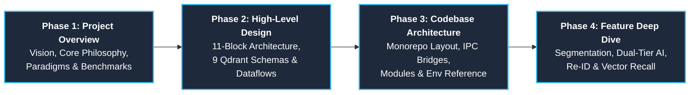

# ReflectWorld Documentation Suite & Architecture Center

Welcome to the comprehensive, production-grade documentation portal for **ReflectWorld** — the continuous, local-first visual-spatial memory system for autonomous physical AI agents and personal ambient intelligences.

This documentation center is organized into four sequential, deep-dive architectural volumes designed for engineers, researchers, and systems architects deploying continuous perception pipelines.

---

## Master Navigation Index



### [Phase 1: Project Overview & Core Philosophy](file:///c:/Users/DELL/Desktop/Mega Project folder/docs/01_PROJECT_OVERVIEW.md)
> *Essential reading for understanding why ReflectWorld exists and how it departs from episodic video AI.*
- **System Vision**: Continuous spatial-temporal cognitive continuity vs. disconnected one-off video queries.
- **Level 0 vs. Level 1 Strategy**: Zero-local-weight VLM mode (commodity hardware) vs native ONNX edge pipeline.
- **Person Re-ID Workflow**: Multi-room and temporal identity tracking across days and weeks.
- **Benchmark Comparisons**: Formal evaluation vs. LangChain, MemGPT, traditional vector stores, and raw VLM pipelines.
- **Privacy Perimeter**: Local-first vector storage and cryptographic edge boundaries.

---

### [Phase 2: High-Level Design (HLD) & Subsystem Architecture](file:///c:/Users/DELL/Desktop/Mega Project folder/docs/02_HIGH_LEVEL_DESIGN.md)
> *System topology, end-to-end dataflows, and Qdrant vector database schema specifications.*
- **Master 11-Block Architecture Diagram**: Microservice topology from camera capture to agent memory recall.
- **Subsystem Deep Dives**: Breakdown of Ingestion, Segmentation, Whisper, Perception, IPC Client, Python FastAPI, Qdrant, Consolidation, Retrieval, and Dashboard.
- **9 Qdrant Vector Collection Schemas**: Detailed dimension, metric (Cosine/Dot), payload schema, and indexing plans for all 9 collections.
- **End-to-End Sequence Diagrams**: Detailed message-by-message traces for Ingestion-to-Write and Natural Language Query Recall.
- **Fault-Tolerance Matrix**: Resilience behaviors for network partitions, VLM rate drops, and vector database reconnections.

---

### [Phase 3: Codebase Architecture & Monorepo Manual](file:///c:/Users/DELL/Desktop/Mega Project folder/docs/03_CODEBASE_ARCHITECTURE.md)
> *Monorepo organization, TypeScript/Python hybrid bridges, and environment configuration dictionary.*
- **Directory Tree & Module Responsibilities**: Explanations of `packages/cam`, `packages/percept`, `services/mem`, `packages/mem`, `packages/reflectworld`, `packages/dashboard`, `packages/host`, and `packages/shared`.
- **Inter-Process Communication (IPC)**: HTTP REST contracts, payload schemas, and serialization formats between Node.js and FastAPI.
- **Exhaustive Configuration Dictionary**: Complete field-by-field reference for every variable in `.env` (perception levels, timeouts, Qdrant URLs, model keys).
- **Build & Verification Lifecycle**: Commands for compilation, typechecking, running single-shot pipeline checks, and local development.

---

### [Phase 4: Feature Deep Dive & Implementation Manual](file:///c:/Users/DELL/Desktop/Mega Project folder/docs/04_FEATURE_DEEP_DIVE.md)
> *Mathematical formulations, algorithmic descriptions, and source code references for core features.*
- **Adaptive Segmentation & Keyframes**: Silero VAD pause arbitration, motion energy deltas, color histogram difference formulas, and tri-keyframe picking.
- **Dual-Tier Perception Engine**: Detailed execution paths for Level 0 (Gemini 3.1 Flash Lite JSON extraction) vs Level 1 (YOLO26m, RetinaFace, ArcFace, RTMPose).
- **Cross-Temporal Entity Resolution (Re-ID)**: Cosine similarity clustering, appearance continuity scoring equations, and trajectory updating.
- **9-Tier Hierarchical Vector Memory**: Consolidation worker algorithms, episodic-to-semantic schema lifting, and biological forgetting formulas.
- **Multi-Modal Retrieval & Grounded Synthesis**: Multi-query decomposition, temporal neighborhood expansion ($\pm 45\text{s}$), and anti-hallucination verification.
- **System Code Trace Reference Map**: Direct links to implementing source files for every subsystem.

---

## Quick Reference: Running the System

```bash
# Terminal 1: Vector Storage Engine (Port 6333)
C:\qdrant\qdrant.exe

# Terminal 2: Python Memory & Consolidation Microservice (Port 8219)
cd services/mem
venv\Scripts\activate
uvicorn src.main:app --port 8219 --reload

# Terminal 3: Main Node.js Orchestrator & Dashboard (Port 3210)
node packages/reflectworld/dist/src/cli/index.js start --dev
```
